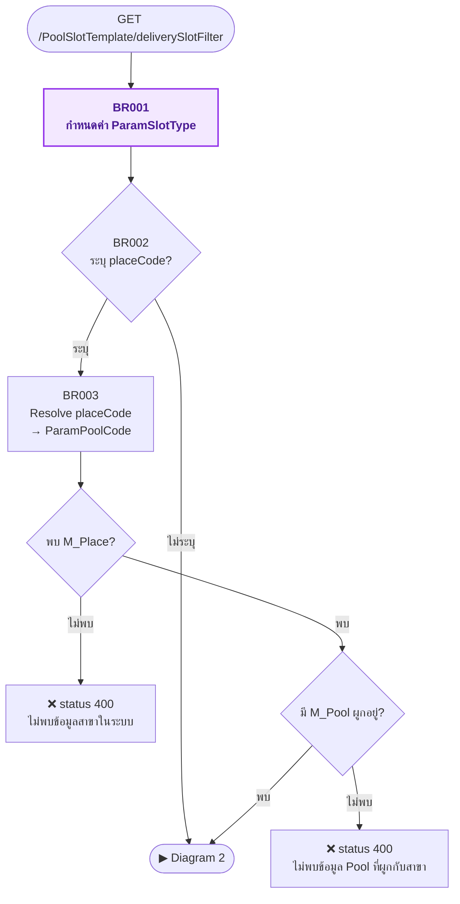
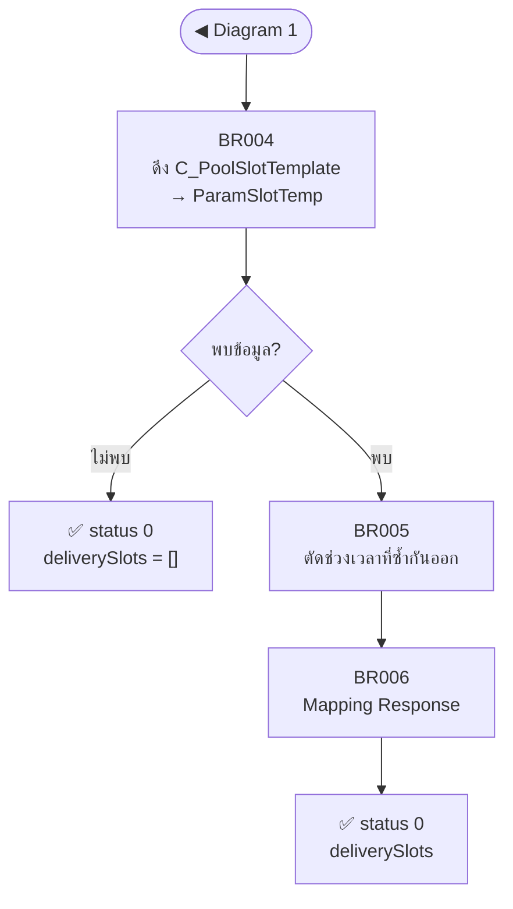

# API Spec: GET /master/cfr/api/PoolSlotTemplate/deliverySlotFilter

## Changelog

| Version | Version date | Author | Reason for change |
|---|---|---|---|
| 1.0 | 2026-07-30 | Pichamon Tretipentr | Initial version — ดึงรายการ Delivery Slot (Time Slot) สำหรับ dropdown filter หน้า "รายการรอจัดรอบรถขนส่งของสาขา" (CFW) |
| 1.1 | 25-09-2026 | Pongskorn Petwong | **เปลี่ยนค่า default `slotType` ฝั่ง `C_PoolSlotTemplate` จาก `'ทั่วไป'` เป็น `'Normal'`** (task 73451 — สอดคล้องกับ `SlotTypeEnums.Normal` ฝั่ง Dev #73452): แก้ §3.2 (slotType default/ENUM), BR001, ตัวอย่างการทำงาน<br>เพิ่ม callout Auth-derived ใต้ `## 3. Request` (ไฟล์นี้ยังไม่เคยมี) · เพิ่ม `## Open Items` (section ใหม่) |

---

## 1. Overview

| Field | Value |
|---|---|
| Endpoint URL | `http://[API-HOST]/master/cfr/api/PoolSlotTemplate/deliverySlotFilter` |
| HTTP Method | GET |
| Required Authentication | Yes |
| Description | ดึงรายการช่วงเวลาจัดส่ง (Delivery Slot) ตามเงื่อนไข filter 4 มิติ (Channel of Sell, Delivery Type, สาขา, Customer VIP Flag) เพื่อแสดงเป็น dropdown filter |
| Controller | /PoolSlotTemplate |
| Action | /PoolSlotTemplate/deliverySlotFilter |

## 1.1 User Story

| | |
|---|---|
| As, ในฐานะ | เจ้าหน้าที่สาขา/Admin หน้า "รายการรอจัดรอบรถขนส่งของสาขา" |
| I want, ฉันต้องการ | ดึงรายการช่วงเวลาจัดส่งตามเงื่อนไข filter ที่เลือกไว้ |
| So what, เพื่อ | นำไปแสดงเป็น dropdown "รอบจัดส่ง" สำหรับกรองรายการ order |

---

## 2. Service

**Master Service**:

- `C_PoolSlotTemplate`
- `M_Place`
- `M_Pool`

---

## 3. Request

> **Auth-derived (server inject — ห้ามรับจาก request body):**
> user = `UserRole.user.userID` · provider = `UserRole.providerCode` · BU = `UserRole.user.bu`
> (request override BUCode ได้เฉพาะ endpoint ที่ระบุเหตุผลไว้)

### 3.1 Request header parameter

| Parameter | Mandatory/Optional | Description |
|---|---|---|
| Authorization | M | Bearer token |
| X-Sprint-Access | M | Bearer token |
| Content-type | M | application/json |

### 3.2 Query parameter

| Parameter | Data type | Mandatory/Optional | Default | Validation | Description |
|---|---|---|---|---|---|
| channelCode | String(50) | O | *(ไม่ระบุ = ดึงทั้งหมด)* | อ้างอิง `M_ChannelOfSell.ChannelCode` | Channel of Sell |
| deliveryOptionCode | String(50) | O | `DIY` | อ้างอิง `C_PoolSlotTemplate.DeliveryOptionCode` | Delivery Type |
| placeCode | String(10) | O | *(ไม่ระบุ = ดึงทั้งหมด)* | อ้างอิง `M_Place.PlaceCode` | สาขา |
| slotType <span style="color:#9333ea;font-weight:700">[NEW]</span> | String(20) | O | `Normal` | ENUM: `VIP`, `Normal` — ค่าอื่นถือเป็น `Normal` (ดู BR001) | Customer VIP Flag |

### Example request

```
GET /master/cfr/api/PoolSlotTemplate/deliverySlotFilter?deliveryOptionCode=DIY&placeCode=00001&slotType=VIP
```

---

## 4. Response

### 4.1 Response parameter

| Parameter | | Data Type | Mandatory/Optional | Description |
|---|---|---|---|---|
| status | | Int | M | สถานะการทำงาน (0:Success, 400:Error, 500:Exception) |
| statusText | | String | M | สถานะการทำงาน (ข้อความ) |
| sprintRequestID | | String | M | Request ID |
| deliverySlots | | Array of Object | M | รายการช่วงเวลาที่ไม่ซ้ำกัน — `[]` เมื่อไม่พบข้อมูลตามเงื่อนไข<br>กรณี Error ไม่ต้องส่ง field นี้กลับมา |
| | startTime | Time | M | เวลาเริ่มรอบ format `HH:mm:ss` |
| | endTime | Time | M | เวลาสิ้นสุดรอบ format `HH:mm:ss` |
| | timeSlotName | String | M | ชื่อรอบ format `HH:mm - HH:mm` |

### Example response parameter

**Case Success**

```json
{
  "status": 0,
  "statusText": "message",
  "sprintRequestID": "2bed37b1-0352-4a7f-a48a-57010e9ed187",
  "deliverySlots": [
    {
      "startTime": "08:00:00",
      "endTime": "12:00:00",
      "timeSlotName": "08:00 - 12:00"
    },
    {
      "startTime": "12:00:00",
      "endTime": "16:00:00",
      "timeSlotName": "12:00 - 16:00"
    }
  ]
}
```

**Case Error**

```json
{
  "status": 400,
  "statusText": "ไม่พบข้อมูลสาขา 00001 ในระบบ",
  "sprintRequestID": "627f22ec-5eb9-4cbf-b2ad-6594027fca95"
}
```

### 4.2 HTTP Status Code

| status | เงื่อนไข | statusText |
|---|---|---|
| 0 | สำเร็จ (รวมกรณีไม่พบข้อมูลตามเงื่อนไข → `deliverySlots = []`) | message |
| 400 | BR003 ไม่พบ `M_Place` ตามเงื่อนไข | ไม่พบข้อมูลสาขา {{ placeCode }} ในระบบ |
| 400 | BR003 พบ `M_Place` แต่ไม่มี `M_Pool` ผูกอยู่ | ไม่พบข้อมูล Pool ที่ผูกกับสาขา {{ placeCode }} ในระบบ |
| 500 | Exception อื่นที่ไม่ได้ระบุใน BR | ข้อความ exception |

### 4.3 Non-functional

| หัวข้อ | ข้อกำหนด |
|---|---|
| Sync / Async | **Sync** — read-only จบภายใน request เดียว ไม่เรียก external service |
| Idempotency | read-only เรียกซ้ำได้ผลลัพธ์เดิม ปลอดภัยต่อการ retry / double-submit |
| Concurrency | ไม่มี write operation จึงไม่ต้องใช้ locking |
| Performance | endpoint ถูกเรียกทุกครั้งที่เปิดหน้า/เปลี่ยน filter (ความถี่สูง) — ต้องมี index รองรับ filter columns `(ProviderCode, PoolCode, DeliveryOptionCode, SlotType)` |

---

## 5. Business Rules

### Diagram 1 — กำหนดค่า Parameter และ Resolve สาขา (BR001–BR003)



| BR Code | Step / Node | Business Rule |
|---|---|---|
| BR001 <span style="color:#9333ea;font-weight:700">[NEW]</span> | ParamSlotType = กำหนดค่า Slot Type | กรณี `Request.slotType = 'VIP'` (exact match) → `ParamSlotType = 'VIP'`<br>กรณีอื่นทั้งหมด (ไม่ระบุ, สะกดผิด, ค่าที่ไม่รู้จัก) → `ParamSlotType = 'Normal'` ไม่แจ้ง Error |
| BR002 | ตรวจสอบการระบุสาขา | กรณี `Request.placeCode` เท่ากับช่องว่างหรือ NULL → `ParamPoolCode = NULL` (ไม่กรองด้วย PoolCode) ข้ามไป BR004<br>กรณีระบุมา → ทำ BR003 |
| BR003 | ParamPoolCode = ดึงข้อมูล M_Place, M_Pool | **WHERE:** `M_Place.PlaceCode = Request.placeCode`<br>• `M_Place.ProviderCode = jwt.providerCode`<br>• `M_Place.IsActive = 1`<br>• กรณีไม่พบข้อมูล → **แจ้ง Error ไม่พบข้อมูลสาขา {{ placeCode }} ในระบบ**<br>• กรณีพบมากกว่า 1 รายการ ให้ใช้รายการแรก เรียงตาม `ORDER BY M_Place.ID ASC`<br><br>**JOIN:** `M_Pool.ID = M_Place.mPoolID`<br>• กรณี `M_Place.mPoolID` เป็น NULL หรือไม่พบ `M_Pool` → **แจ้ง Error ไม่พบข้อมูล Pool ที่ผูกกับสาขา {{ placeCode }} ในระบบ**<br>• กรณีพบข้อมูล → `ParamPoolCode = M_Pool.PoolCode` |

### Diagram 2 — ดึง Slot Template และ Build Response (BR004–BR006)



| BR Code | Step / Node | Business Rule |
|---|---|---|
| BR004 | ParamSlotTemp = ดึงข้อมูล C_PoolSlotTemplate | **1. เงื่อนไขหลัก**<br>• `C_PoolSlotTemplate.ProviderCode = jwt.providerCode`<br>• `C_PoolSlotTemplate.SlotType = ParamSlotType`<br><br>**2. เงื่อนไข PoolCode**<br>• กรณี `ParamPoolCode` ไม่เท่ากับ NULL → `C_PoolSlotTemplate.PoolCode = ParamPoolCode`<br>• กรณี `ParamPoolCode` เท่ากับ NULL → ไม่ต้องกรองด้วย PoolCode<br><br>**3. เงื่อนไข ChannelCode**<br>• กรณี `Request.channelCode` ไม่เท่ากับช่องว่างหรือ NULL → `C_PoolSlotTemplate.ChannelCode = Request.channelCode`<br>• กรณีเท่ากับช่องว่างหรือ NULL → ไม่ต้องกรองด้วย ChannelCode<br><br>**4. เงื่อนไข DeliveryOptionCode**<br>• กรณี `Request.deliveryOptionCode` ไม่เท่ากับช่องว่างหรือ NULL → `C_PoolSlotTemplate.DeliveryOptionCode = Request.deliveryOptionCode`<br>• กรณีเท่ากับช่องว่างหรือ NULL → `C_PoolSlotTemplate.DeliveryOptionCode = 'DIY'`<br><br>**5. ผลลัพธ์**<br>• `ParamSlotTemp` = รายการที่ตรงเงื่อนไขทั้งหมด<br>• กรณีไม่พบข้อมูล → คืน `deliverySlots = []` พร้อม `status = 0` |
| BR005 | ตัดช่วงเวลาที่ซ้ำกันออก | **SELECT DISTINCT** `ParamSlotTemp.StartTime`, `ParamSlotTemp.EndTime`<br>• หลายรายการที่ `StartTime` และ `EndTime` ตรงกัน (ต่าง PoolCode หรือ ChannelCode กัน) นับเป็น 1 รายการ |
| BR006 | Mapping Response parameter (Build Response) | เรียงลำดับด้วย `ORDER BY StartTime ASC, EndTime ASC`<br>ดูรายละเอียดเต็มที่ตาราง **Field Mapping** ด้านล่าง |

---

## Field Mapping

| Response Field | | Data Type | Mapping / Formula |
|---|---|---|---|
| status | | Int | สถานะการทำงาน |
| statusText | | String | ข้อความสถานะ |
| sprintRequestID | | String | Request ID |
| deliverySlots | | Array of Object | |
| | startTime | Time | `ParamSlotTemp.StartTime` format `HH:mm:ss` |
| | endTime | Time | `ParamSlotTemp.EndTime` format `HH:mm:ss` |
| | timeSlotName | String | `ParamSlotTemp.StartTime format HH:mm + " - " + ParamSlotTemp.EndTime format HH:mm` |

### ตัวอย่างการทำงาน

**ข้อมูลตั้งต้นใน `C_PoolSlotTemplate`** (`ProviderCode = 'CFW'`)

| Id | PoolCode | ChannelCode | DeliveryOptionCode | SlotType | StartTime | EndTime |
|---|---|---|---|---|---|---|
| 1 | P01 | WA | DIY | Normal | 08:00 | 12:00 |
| 7 | P02 | ONL | DIY | Normal | 08:00 | 12:00 |
| 2 | P01 | WA | DIY | Normal | 12:00 | 16:00 |
| 3 | P01 | *(NULL)* | DIY | VIP | 08:00 | 10:00 |

**Request:** ระบุแค่ `deliveryOptionCode = DIY` (ไม่ระบุ `channelCode`, `placeCode`, `slotType`)

| BR | ผลลัพธ์ |
|---|---|
| BR001 | `ParamSlotType = 'Normal'` (default) |
| BR002 | `ParamPoolCode = NULL` (ไม่ระบุสาขา) |
| BR004 | ตัด Id 3 ออก (`SlotType = VIP`) → `ParamSlotTemp` = Id 1, 7, 2 |
| BR005 | Id 1 กับ Id 7 ช่วงเวลาตรงกัน (08:00-12:00) แม้ต่าง PoolCode และ ChannelCode → เหลือ 2 รายการ |

**deliverySlots ที่ได้**

```json
[
  { "startTime": "08:00:00", "endTime": "12:00:00", "timeSlotName": "08:00 - 12:00" },
  { "startTime": "12:00:00", "endTime": "16:00:00", "timeSlotName": "12:00 - 16:00" }
]
```

---

## Open Items

> ตารางนี้เก็บเฉพาะงาน DEV ของ v1.1 (ไฟล์นี้ยังไม่เคยมี Open Items section มาก่อน)

| ID | รายละเอียด | ประเภท | เจ้าของ |
|---|---|---|---|
| OI-1 <span style="color:#9333ea;font-weight:700">[NEW]</span> | **ภาพรวมงาน:** เปลี่ยนค่าคงที่ `SlotTypeEnums.Normal` (`TMS.MasterData/TMS.MasterDataService/CFR/Constants/SlotTypeConstants.cs`) จาก `"ทั่วไป"` เป็น `"Normal"` — ให้ตรงกับ BR001 ของ spec นี้ (Dev #73452 — งานเดียวกันข้ามหลาย spec coordinate ให้ deploy พร้อมกัน) | 🔴 Blocking | Dev |

---

## QA Test cURL

```bash
curl -X GET '{{base_url}}/master/cfr/api/PoolSlotTemplate/deliverySlotFilter?deliveryOptionCode=DIY&placeCode=00001&slotType=VIP' \
  -H 'Authorization: Bearer <JWT_TOKEN>' \
  -H 'X-Sprint-Access: Bearer <SPRINT_ACCESS_TOKEN>' \
  -H 'Content-Type: application/json'
```

```json
{
  "status": 0,
  "statusText": "message",
  "sprintRequestID": "2bed37b1-0352-4a7f-a48a-57010e9ed187",
  "deliverySlots": [
    {
      "startTime": "08:00:00",
      "endTime": "10:00:00",
      "timeSlotName": "08:00 - 10:00"
    },
    {
      "startTime": "10:00:00",
      "endTime": "12:00:00",
      "timeSlotName": "10:00 - 12:00"
    }
  ]
}
```
