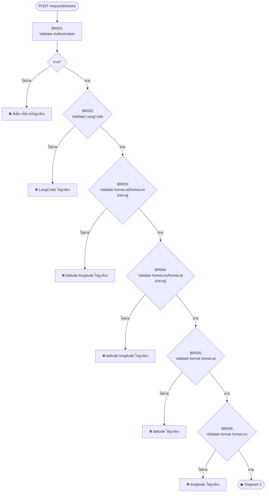
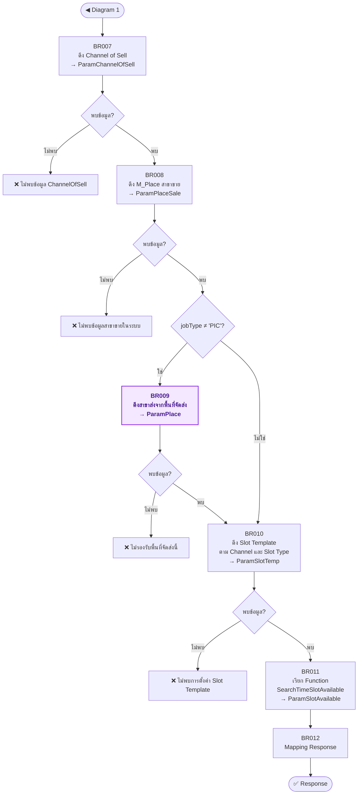

# API Spec: POST /cfr/api/booking/{LangCode}/requesttimeslot

---

## Changelog

| Version | Version date | Author | Reason for change |
|---|---|---|---|
| 1.0 | 09-04-2026 | Pongskorn Petwong | Initial version |
| 1.1 | 12-05-2026 | Pongskorn Petwong | เพิ่มเงื่อนไขการค้นหาด้วย saleSource<br>ปรับ msg error |
| 1.2 | 24-07-2026 | Pichamon Tretipentr | เพิ่มการรองรับ Slot Type VIP<br>เพิ่ม Request parameter slotType<br>ปรับ BR009 เงื่อนไขการดึง C_PoolSlotTemplate<br>ปรับ BR010 ส่ง slotType เข้า Function<br>ปรับ qty และ items[].qty ให้รองรับค่าทศนิยม (Decimal) |
| 1.3 | 19-08-2026 | Pongskorn Petwong | เพิ่ม BR008 validate M_Place (สาขาขาย)<br>แยก logic ดึงสาขาส่งตาม jobType: `≠ 'PIC'` ใช้ BR009 (พื้นที่จัดส่งจาก address) / `= 'PIC'` ใช้ Pool จาก BR008 โดยตรง<br>ปรับ BR010–BR011 (เดิม BR009–BR010) ให้รองรับที่มา PoolCode / mPlaceIDSend ตาม jobType<br>เลื่อนเลข BR009–BR011 (เดิม) เป็น BR010–BR012<br>เพิ่มเงื่อนไข BR009 `M_Place.MechandiseCode = Request.saleByStore` |

---

## 1. Overview

| Field | Value |
|---|---|
| Endpoint URL | `http://[API-HOST]/cfr/api/booking/{LangCode}/requesttimeslot` |
| HTTP Method | POST |
| Required Authentication | Yes |
| Description | ดึงข้อมูล Slot |
| Controller | /booking |
| Action | /booking/requesttimeslot |

## 1.1 User Story

| | |
|---|---|
| As, ในฐานะ | ผู้ใช้งาน |
| I want, ฉันต้องการ | ดึงข้อมูล Slot |
| So what, เพื่อ | เพื่อเลือกช่วงเวลาจัดส่งสินค้าที่ต้องการ |

## 2. Service

**Master Service**:

- `C_ConfigAccess`
- `M_ChannelOfSell`
- `C_PlaceArea`
- `M_Place`
- `M_Pool`
- `M_Province`
- `M_District`
- `M_SubDistrict`
- `M_SubDistrictGeo`
- `C_PoolSlotTemplate`

---

## 3. Request

### 3.1 Path parameter

| Parameter | Data type | Mandatory/Optional | Validation | Description |
|---|---|---|---|---|
| LangCode | String(2) | M | ENUM: `TH`, `EN` | Lanaguage EN/TH<br>สำหรับ Setting response ตามภาษาที่เลือก |

### 3.2 Request header parameter

| Parameter | Mandatory/Optional | Description |
|---|---|---|
| Authorization | M | Bearer token |
| X-Sprint-Access | M | Bearer token |
| Content-type | M | application/json |

### 3.3 Request body parameter

| Parameter                                                         |                                                              | Data type       | Mandatory/Optional | Validation                                        | Description                                           |
| ----------------------------------------------------------------- | ------------------------------------------------------------ | --------------- | ------------------ | ------------------------------------------------- | ----------------------------------------------------- |
| saleSource                                                        |                                                              | String(255)     | M                  | อ้างอิง `M_ChannelOfSell.ShortName`               | saleSource                                            |
| slotType |                                                              | String(20)      | O                  | ค่าอื่นที่ไม่ใช่ `VIP` → กำหนดเป็น `ทั่วไป` | slotType<br>"VIP" = ลูกค้า VIP<br>null = ลูกค้าทั่วไป<br>ค่าที่ไม่ใช่ค่าว่างหรือ NULL และไม่ใช่ `VIP` → กำหนดเป็น `ทั่วไป` |
| saleByStore                                                       |                                                              | String(10)      | M                  | อ้างอิง `M_Place.MechandiseCode` | saleByStore                                           |
| deliveryByStore                                                   |                                                              | String(10)      | O                  | อ้างอิง `M_Place.PlaceCode`                       | deliveryByStore                                       |
| provinceName                                                      |                                                              | String(100)     | O                  |                                                   | provinceName                                          |
| districtName                                                      |                                                              | String(100)     | O                  |                                                   | districtName                                          |
| subDistrictName                                                   |                                                              | String(100)     | O                  |                                                   | subDistrictName                                       |
| postalCode                                                        |                                                              | String(5)       | M                  | ตัวเลข 5 หลัก อ้างอิง `M_SubDistrict.Zipcode`     | postalCode                                            |
| homeLat                                                           |                                                              | Decimal(9,6)    | O                  | -90.000000 ถึง 90.000000                          | homeLat                                               |
| homeLon                                                           |                                                              | Decimal(9,6)    | O                  | -180.000000 ถึง 180.000000                        | homeLon                                               |
| jobType                                                           |                                                              | String(50)      | M                  | อ้างอิง `C_PoolSlotTemplate.DeliveryOptionCode`   | jobType                                               |
| truckType                                                         |                                                              | String(10)      | O                  | อ้างอิง `M_TruckType.TruckTypeCode`               | truckType                                             |
| qty      |                                                              | Decimal(18,2)   | O                  | >= 0                                              | qty                                                   |
| packageWeight                                                     |                                                              | int             | O                  | >= 0                                              | packageWeight                                         |
| packageVolume                                                     |                                                              | int             | O                  | >= 0                                              | packageVolume                                         |
| totalPrice                                                        |                                                              | Decimal(18,2)   | O                  | >= 0                                              | totalPrice                                            |
| serviceUpcCode                                                    |                                                              | String(20)      | O                  |                                                   | serviceUpcCode                                        |
| fromDeliveryDate                                                  |                                                              | String(10)      | M                  | format `YYYY-MM-DD`                               | fromDeliveryDate                                      |
| toDeliveryDate                                                    |                                                              | String(10)      | M                  | format `YYYY-MM-DD`<br>ต้อง >= `fromDeliveryDate` | toDeliveryDate                                        |
| items                                                             |                                                              | Array of Object | O                  |                                                   |                                                       |
|                                                                   | skuCode                                                      | String(20)      | O                  |                                                   | skuCode                                               |
|                                                                   | upcCode                                                      | String(20)      | O                  |                                                   | upcCode                                               |
|                                                                   | qty | Decimal(18,2)   | O                  | >= 0                                              | qty                                                   |

### Example request body parameter

```json
{
    "saleSource": "WA",
    "slotType": null,
    "saleByStore": "00001",
    "deliveryByStore": "",
    "fromDeliveryDate ": "2026-04-01",
    "toDeliveryDate ": "2026-04-02",
    "provinceName": "",
    "districtName": "",
    "subDistrictName": "",
    "postalCode": "10560",
    "homeLat": "",
    "homeLon": "",
    "jobType": "DIY",
    "truckType": "",
    "qty": 1.00,
    "packageWeight": 0,
    "packageVolume": 0,
    "totalPrice": 0,
    "serviceUpcCode": "",
    "items": [
      {
        "skuCode": "",
        "upcCode": "",
        "qty": 0.00
      }
    ]
  }
```

---

## 4. Response

### 4.1 Response parameter

| Parameter | | | Data type | Mandatory/Optional | Description |
|---|---|---|---|---|---|
| errorMessage | | | string | M | ข้อความสถานะ |
| errorCode | | | int | O | สถานะ |
| systemDateTime | | | string | O | Request ID |
| masterTimeslots | | | Array of Object | | |
| | timeslotCode | | string | M | timeslotCode |
| | timeslotName | | string | M | timeslotName |
| | timeslotDesc | | string | M | timeslotDesc |
| | durationHour | | int | M | durationHour |
| data | | | Array of Object | | |
| | deliveryDate | | date | M | deliveryDate |
| | timeslots | | Array of Object | | |
| | | timeSlotCode | string | M | timeSlotCode |
| | | timeSlotName | string | M | timeSlotName |
| | | isAvailable | string | M | isAvailable |
| | | deliveryCharge | int | M | deliveryCharge |
| | | timeSlotDesc | string | M | timeSlotDesc |

### Example response parameter

```json
{
  "errorMessage": "",
  "errorCode": 0,
  "systemDateTime": "20260402T080233Z",
  "masterTimeslots": [
    {
      "timeslotCode": "TimeSlotTemplate-1",
      "timeslotName": "08:00-12:00",
      "timeslotDesc": "08:00-12:00",
      "durationHour": 10
    },
    {
      "timeslotCode": "TimeSlotTemplate-2",
      "timeslotName": "12:00-16:00",
      "timeslotDesc": "12:00-16:00",
      "durationHour": 4
    }
  ],
  "data": [
    {
      "deliveryDate": "2026-04-02",
      "timeslots": [
        {
          "timeSlotCode": "TimeSlotTemplate-1",
          "timeSlotName": "08:00-12:00",
          "isAvailable": "N",
          "deliveryCharge": 0,
          "timeSlotDesc": "08:00-12:00"
        },
        {
          "timeSlotCode": "TimeSlotTemplate-2",
          "timeSlotName": "12:00-16:00",
          "isAvailable": "N",
          "deliveryCharge": 0,
          "timeSlotDesc": "12:00-16:00"
        }
      ]
    },
    {
      "deliveryDate": "2026-04-03",
      "timeslots": [
        {
          "timeSlotCode": "TimeSlotTemplate-1",
          "timeSlotName": "08:00-12:00",
          "isAvailable": "Y",
          "deliveryCharge": 0,
          "timeSlotDesc": "08:00-12:00"
        },
        {
          "timeSlotCode": "TimeSlotTemplate-2",
          "timeSlotName": "12:00-16:00",
          "isAvailable": "Y",
          "deliveryCharge": 0,
          "timeSlotDesc": "12:00-16:00"
        }
      ]
    },
    {
      "deliveryDate": "2026-04-04",
      "timeslots": [
        {
          "timeSlotCode": "TimeSlotTemplate-1",
          "timeSlotName": "08:00-12:00",
          "isAvailable": "Y",
          "deliveryCharge": 0,
          "timeSlotDesc": "08:00-12:00"
        },
        {
          "timeSlotCode": "TimeSlotTemplate-2",
          "timeSlotName": "12:00-16:00",
          "isAvailable": "Y",
          "deliveryCharge": 0,
          "timeSlotDesc": "12:00-16:00"
        }
      ]
    }
  ]
}
```

### 4.2 HTTP Status Code

| Status | errorCode | เงื่อนไข | errorMessage |
|---|---|---|---|
| 200 | 0 | สำเร็จ | `""` |
| 401 | 4001 | BR001 ไม่พบ `C_ConfigAccess` ที่ตรงเงื่อนไข | สิทธิ์การใช้งานไม่ถูกต้อง |
| 400 | 4002 | BR002 `LangCode` ไม่ใช่ TH/EN | LangCode ต้องเป็น EN หรือ TH เท่านั้น |
| 400 | 4003 | BR003 / BR004 `homeLat`+`homeLon` ส่งมาไม่ครบคู่ | ข้อมูล latitude longitude ไม่ถูกต้อง |
| 400 | 4004 | BR005 `homeLat` ผิด format | ข้อมูล latitude ไม่ถูกต้อง |
| 400 | 4005 | BR006 `homeLon` ผิด format | ข้อมูล longitude ไม่ถูกต้อง |
| 400 | 4006 | BR007 ไม่พบ `M_ChannelOfSell` | ไม่พบข้อมูล ChannelOfSell ในระบบ |
| 400 | 4007 | BR008 ไม่พบ `M_Place` (สาขาขาย) ที่ตรงเงื่อนไข | ไม่พบข้อมูลสาขาขายในระบบ |
| 400 | 4008 | BR009 ไม่พบ `C_PlaceArea` ที่ตรงเงื่อนไข (เฉพาะกรณี `jobType ≠ 'PIC'`) | ไม่พบข้อมูล Slot Delivery service not support for the address. |
| 400 | 4009 | BR010 ไม่พบ `C_PoolSlotTemplate` | ไม่พบข้อมูลการตั้งค่า Slot Template |
| 500 | 5000 | Function `SearchTimeSlotAvailable` ตอบ error หรือ exception อื่นที่ไม่ได้ระบุใน BR | ข้อความ error ที่ได้รับจาก Function |

### 4.3 Non-functional

| หัวข้อ | ข้อกำหนด |
|---|---|
| Sync / Async | **Sync** — BR011 เรียก Function `SearchTimeSlotAvailable` แล้วรอผลลัพธ์เพื่อ mapping ต่อใน BR012 ภายใน request เดียวกัน |
| Function error | กรณี Function ตอบ error ให้ยกเลิกการทำงานทันที และคืน `errorCode` / `errorMessage` ที่ได้รับจาก Function กลับไปตรงๆ ไม่ต้อง retry |
| Idempotency | Endpoint นี้เป็น **read-only** ไม่มีการเขียนข้อมูล — เรียกซ้ำด้วย request เดิมจะได้ผลลัพธ์เดิม (ยกเว้นกรณีที่ Capacity เปลี่ยนระหว่างการเรียก) ปลอดภัยต่อการ retry / double-submit |
| Concurrency | ไม่มี write operation จึงไม่ต้องใช้ locking |

---

## 5. Business Rules

### Diagram 1 — Validate Require Field (BR001–BR006)



| BR Code | Step / Node | Business Rule |
|---|---|---|
| BR001 | ตรวจสอบ Authorization จาก header parameter ที่ตาราง C_Access | **WHERE:** `C_ConfigAccess.Token = Authorization จาก header parameter`<br>• `C_ConfigAccess.AccessType = 'INBOUND'`<br>• กรณีที่ไม่พบข้อมูลให้ระบบทำการแจ้งเตือน → **แจ้ง Error สิทธิ์การใช้งานไม่ถูกต้อง** |
| BR002 | Validate LangCode | กรณี `Request.LangCode` ไม่เท่ากับ "TH" หรือ "EN" → **แจ้ง Error LangCode ต้องเป็น EN หรือ TH เท่านั้น** |
| BR003 | Validate homeLat/homeLon (1) | กรณี `Request.homeLat` เท่ากับช่องว่างหรือ NULL และ `Request.homeLon` ไม่เท่ากับช่องว่างหรือ NULL → **แจ้ง Error ข้อมูล latitude longitude ไม่ถูกต้อง** |
| BR004 | Validate homeLat/homeLon (2) | กรณี `Request.homeLat` ไม่เท่ากับช่องว่างหรือ NULL และ `Request.homeLon` เท่ากับช่องว่างหรือ NULL → **แจ้ง Error ข้อมูล latitude longitude ไม่ถูกต้อง** |
| BR005 | Validate homeLat format | กรณี `Request.homeLat` ไม่เป็นไปตาม Format latitude → **แจ้ง Error ข้อมูล latitude ไม่ถูกต้อง** |
| BR006 | Validate homeLon format | กรณี `Request.homeLon` ไม่เป็นไปตาม Format longitude → **แจ้ง Error ข้อมูล longitude ไม่ถูกต้อง** |

---

### Diagram 2 — ดึงข้อมูลและ Build Response (BR007–BR012)



| BR Code                                                        | Step / Node                                                                                          | Business Rule                                                                                                                                                                                                                                                                                                                                                                                                                                                                                                                                                                                                                                                                                                                                                                                                                                                                                                                                                                                                                                                                                                                                                                                                                                                                                                                                                                        |
| -------------------------------------------------------------- | ---------------------------------------------------------------------------------------------------- | ------------------------------------------------------------------------------------------------------------------------------------------------------------------------------------------------------------------------------------------------------------------------------------------------------------------------------------------------------------------------------------------------------------------------------------------------------------------------------------------------------------------------------------------------------------------------------------------------------------------------------------------------------------------------------------------------------------------------------------------------------------------------------------------------------------------------------------------------------------------------------------------------------------------------------------------------------------------------------------------------------------------------------------------------------------------------------------------------------------------------------------------------------------------------------------------------------------------------------------------------------------------------------------------------------------------------------------------------------------------------------------ |
| BR007                                                          | ParamChannelOfSell = ดึงข้อมูล M_ChannelOfSell                                                       | **WHERE:** `M_ChannelOfSell.ShortName = Request.saleSource`<br>• `M_ChannelOfSell.IsActive = 1`<br>• `M_ChannelOfSell.ProviderCode = jwt.providerCode`<br>• กรณีไม่พบข้อมูล → **แจ้ง Error ไม่พบข้อมูล ChannelOfSell ในระบบ**                                                                                                                                                                                                                                                                                                                                                                                                                                                                                                                                                                                                                                                                                                                                                                                                                                                                                                                                                                                                                                                                                                                                                        |
| BR008 | ParamPlaceSale = ดึงข้อมูล M_Place (สาขาขาย)                                                          | **WHERE:** `M_Place.MechandiseCode = Request.saleByStore`<br>• `M_Place.ProviderCode = jwt.providerCode`<br>• `M_Place.IsActive = 1`<br>• `M_Pool.ID = M_Place.mPoolID`<br>• `M_Pool.IsActive = 1`<br>**ผลลัพธ์ ParamPlaceSale:**<br>• `ParamPlaceSale.Id = M_Place.ID`<br>• `ParamPlaceSale.PoolCode = M_Pool.PoolCode` ของ Pool ที่ join ได้จาก `M_Place.mPoolID`<br>• กรณีไม่พบข้อมูล → **แจ้ง Error ไม่พบข้อมูลสาขาขายในระบบ** |
| BR009 <span style="color:#9333ea;font-weight:700">[NEW]</span> | ParamPlace = ดึงข้อมูล C_PlaceArea, M_Province, M_District, M_SubDistrict, M_Place, M_SubDistrictGeo | **ทำงานเฉพาะกรณี `Request.jobType ≠ 'PIC'`** — กรณี `Request.jobType` เท่ากับ `'PIC'` ให้ข้ามขั้นตอนนี้ทั้งหมด แล้วใช้ `ParamPlaceSale` (จาก BR008) แทนต่อใน BR010–BR011<br><br>**WHERE:** `C_PlaceArea.ProviderCode = jwt.providerCode`<br>• `C_PlaceArea.mProvinceID = M_Province.ID`<br>• `C_PlaceArea.mDistrictID = M_District.ID`<br>• `C_PlaceArea.mSubDistrictID = M_SubDistrict.ID`<br>• `C_PlaceArea.mPlaceID = M_Place.ID`<br>• `M_Place.MechandiseCode = Request.saleByStore` <span style="color:#9333ea;font-weight:700">[NEW]</span><br>• `M_Pool.ID = M_Place.mPoolID`<br>• `C_PlaceArea.mSubDistrictID = M_SubDistrictGeo.mSubDistrictID`<br>• `M_Place.IsActive = 1`<br>• `M_Place.IsHomeDelivery = 1`<br>• `C_PlaceArea.mChannelOfSellID = ParamChannelOfSell.ID`<br>**เงื่อนไขการค้นหา:**<br>• `(M_Province.NameLocal like Request.provinceName% หรือ M_Province.NameEN like Request.provinceName%)`<br>• `(M_District.NameLocal like Request.districtName% หรือ M_District.NameEN like Request.districtName%)`<br>• `(M_SubDistrict.NameLocal like Request.subDistrictName% หรือ M_SubDistrict.NameEN like Request.subDistrictName%)`<br>• `M_SubDistrict.Zipcode = Request.postalCode`<br>• `M_SubDistrictGeo.SubDistrictGeo.STIntersects(geometry::Point(Request.homeLat, Request.homeLon, 4326)) = 1`<br>**ผลลัพธ์ ParamPlace:**<br>• `ParamPlace.PoolCode` = `M_Pool.PoolCode` ของ Pool ที่ join ได้จาก `M_Place.mPoolID`<br>• กรณีพบมากกว่า 1 รายการ ให้ใช้รายการแรก เรียงตาม `ORDER BY M_Place.PlaceCode ASC`<br>• กรณีพบข้อมูล → ให้ทำขั้นตอนถัดไป<br>• กรณีไม่พบข้อมูล → **แจ้ง Error ไม่พบข้อมูล Slot Delivery service not support for the address.** |
| BR010 | ParamSlotTemp = ดึงข้อมูล C_PoolSlotTemplate                                                         | **0. ที่มาของ PoolCode (ตาม jobType)**<br>• กรณี `Request.jobType ≠ 'PIC'` → ใช้ `ParamPlace.PoolCode` (จาก BR009)<br>• กรณี `Request.jobType = 'PIC'` → ใช้ `ParamPlaceSale.PoolCode` (จาก BR008)<br><br>**1. เงื่อนไขหลัก**<br>• `C_PoolSlotTemplate.ProviderCode = jwt.providerCode`<br>• `C_PoolSlotTemplate.PoolCode = ` PoolCode จากข้อ 0<br>• `C_PoolSlotTemplate.DeliveryOptionCode = Request.jobType`<br><br>**2. เงื่อนไข ChannelCode**<br>`ChannelCode` เป็นคอลัมน์ตัวเลือก — กรณีเป็นค่า NULL หมายถึงใช้ได้กับทุก Channel of Sell ไม่เจาะจงข้อมูล<br>• ดึงรายการที่ `C_PoolSlotTemplate.ChannelCode = M_ChannelOfSell.ChannelCode` **หรือ** `C_PoolSlotTemplate.ChannelCode = NULL`<br>• กรณีพบรายการที่ `StartTime`, `EndTime`, `SlotType` เดียวกันหลายรายการ ให้ใช้รายการที่ `ChannelCode` ไม่เป็น NULL ก่อน<br><br>**3. เงื่อนไข SlotType**<br>• กรณี `Request.slotType = 'VIP'` → `C_PoolSlotTemplate.SlotType` เป็น `'VIP'` หรือ `'ทั่วไป'`<br>• กรณี `Request.slotType = null` → `C_PoolSlotTemplate.SlotType = 'ทั่วไป'`<br>• กรณี `Request.slotType` ไม่เท่ากับค่าว่างหรือ NULL และไม่เท่ากับ `'VIP'` → กำหนดเป็น `'ทั่วไป'` แล้วใช้เงื่อนไข `C_PoolSlotTemplate.SlotType = 'ทั่วไป'`<br><br>**4. ผลลัพธ์**<br>• เรียงลำดับด้วย `ORDER BY C_PoolSlotTemplate.StartTime ASC, C_PoolSlotTemplate.EndTime ASC, C_PoolSlotTemplate.Id ASC`<br>• กรณีไม่พบข้อมูล → **แจ้ง Error ไม่พบข้อมูลการตั้งค่า Slot Template**                                                                                                                                                                                                                                                                                                                        |
| BR011 | ParamSlotAvailable = เรียกใช้งาน Function : SearchTimeSlotAvailable                                  | **ด้วยข้อมูล:**<br>• `mPlaceIDSend` — กรณี `Request.jobType ≠ 'PIC'` → `ParamPlace.Id` (M_Place.ID จาก BR009)<br>&nbsp;&nbsp;กรณี `Request.jobType = 'PIC'` → `ParamPlaceSale.Id` (M_Place.ID จาก BR008)<br>• `fromDeliveryDate = Request.fromDeliveryDate`<br>• `toDeliveryDate = Request.toDeliveryDate`<br>• `saleSource = Request.saleSource`<br>• `deliveryOptionCode = Request.jobType`<br>• `slotType` — กรณี `Request.slotType` เท่ากับ `'VIP'` → ส่งค่า `'VIP'`<br>&nbsp;&nbsp;กรณีอื่น (ค่าว่าง, NULL หรือค่าที่ไม่ใช่ `'VIP'`) → ส่งค่า `'ทั่วไป'`                                                                                                                                                                                                                                                                                                                                                                                                                                                                                                                                                                                                                                                                                                                                                                                                                                                                                                                                                                                                                                                                                                             |
| BR012                                                          | Mapping Response parameter (Build Response)                                                          | ดูรายละเอียดเต็มที่ตาราง **Field Mapping** ด้านล่าง                                                                                                                                                                                                                                                                                                                                                                                                                                                                                                                                                                                                                                                                                                                                                                                                                                                                                                                                                                                                                                                                                                                                                                                                                                                                                                                                  |

### ตัวอย่าง BR010 — การดึงข้อมูล C_PoolSlotTemplate

**ข้อมูลตั้งต้นใน C_PoolSlotTemplate** (`PoolCode = 'P01'`, `DeliveryOptionCode = 'DIY'`, `ProviderCode = 'CFW'`)

| Id | SlotType | ChannelCode | StartTime | EndTime | Capacity | Duration | CutOffTime |
|---|---|---|---|---|---|---|---|
| 1 | ทั่วไป | WA | 08:00 | 12:00 | 150 | 0 | 18:00 |
| 2 | ทั่วไป | WA | 12:00 | 16:00 | 150 | 0 | 16:00 |
| 3 | ทั่วไป | ONL | 08:00 | 12:00 | 150 | 0 | 18:00 |
| 4 | VIP | *(NULL)* | 08:00 | 10:00 | 100 | 0 | 18:00 |
| 5 | VIP | *(NULL)* | 10:00 | 12:00 | 100 | 0 | 18:00 |
| 6 | VIP | *(NULL)* | 12:00 | 14:00 | 100 | 0 | 16:00 |
| 7 | VIP | *(NULL)* | 14:00 | 16:00 | 100 | 0 | 16:00 |

Slot VIP แบ่งช่วงละ 2 ชั่วโมง ถี่กว่า Slot ทั่วไปที่แบ่งช่วงละ 4 ชั่วโมง และตั้ง `ChannelCode` เป็น NULL หมายถึงใช้ได้กับทุก Channel of Sell

`durationHour` ในตัวอย่างด้านล่างคำนวณตาม Field Mapping คือ `(Date.Now - Duration(วัน) + " " + CutOffTime) - (Date.Now + " " + StartTime)` เช่น Id 1 = `18:00 - 08:00` = 10 ชั่วโมง

---

**กรณีที่ 1 — `Request.saleSource = 'WA'`, `Request.slotType = 'VIP'`**

| Id | SlotType | ChannelCode | ผลการกรอง |
|---|---|---|---|
| 1 | ทั่วไป | WA | ✅ ChannelCode ตรง · SlotType อยู่ในเงื่อนไข |
| 2 | ทั่วไป | WA | ✅ ChannelCode ตรง · SlotType อยู่ในเงื่อนไข |
| 3 | ทั่วไป | ONL | ❌ ChannelCode ไม่ตรงกับ `M_ChannelOfSell.ChannelCode` |
| 4 | VIP | *(NULL)* | ✅ ChannelCode เป็น NULL (ทุก Channel) · SlotType ตรง |
| 5 | VIP | *(NULL)* | ✅ ChannelCode เป็น NULL (ทุก Channel) · SlotType ตรง |
| 6 | VIP | *(NULL)* | ✅ ChannelCode เป็น NULL (ทุก Channel) · SlotType ตรง |
| 7 | VIP | *(NULL)* | ✅ ChannelCode เป็น NULL (ทุก Channel) · SlotType ตรง |

`ParamSlotTemp` = 6 รายการ (VIP 4 + ทั่วไป 2) — ต้องดึง Slot ทั่วไปมาด้วยเสมอ เนื่องจาก Function `SearchTimeSlotAvailable` อาจ Fallback ไปใช้ Slot ทั่วไปในวันที่ Slot VIP เต็ม ทำให้ `masterTimeslots` ต้องมีรายการครบทั้งสองประเภท

**masterTimeslots ที่ได้**

```json
"masterTimeslots": [
  { "timeslotCode": "TimeSlotTemplate-1", "timeslotName": "08:00 - 12:00", "timeslotDesc": "08:00 - 12:00", "durationHour": 10 },
  { "timeslotCode": "TimeSlotTemplate-2", "timeslotName": "12:00 - 16:00", "timeslotDesc": "12:00 - 16:00", "durationHour": 4 },
  { "timeslotCode": "TimeSlotTemplate-4", "timeslotName": "08:00 - 10:00", "timeslotDesc": "08:00 - 10:00", "durationHour": 10 },
  { "timeslotCode": "TimeSlotTemplate-5", "timeslotName": "10:00 - 12:00", "timeslotDesc": "10:00 - 12:00", "durationHour": 8 },
  { "timeslotCode": "TimeSlotTemplate-6", "timeslotName": "12:00 - 14:00", "timeslotDesc": "12:00 - 14:00", "durationHour": 4 },
  { "timeslotCode": "TimeSlotTemplate-7", "timeslotName": "14:00 - 16:00", "timeslotDesc": "14:00 - 16:00", "durationHour": 2 }
]
```

---

**กรณีที่ 2 — `Request.saleSource = 'WA'`, `Request.slotType = null`**

| Id | SlotType | ChannelCode | ผลการกรอง |
|---|---|---|---|
| 1 | ทั่วไป | WA | ✅ ChannelCode ตรง · SlotType ตรง |
| 2 | ทั่วไป | WA | ✅ ChannelCode ตรง · SlotType ตรง |
| 3 | ทั่วไป | ONL | ❌ ChannelCode ไม่ตรง |
| 4–7 | VIP | *(NULL)* | ❌ SlotType ไม่อยู่ในเงื่อนไข |

`ParamSlotTemp` = 2 รายการ (ทั่วไปเท่านั้น) — ไม่มีรายการ Slot VIP ปรากฏใน `masterTimeslots`

**masterTimeslots ที่ได้**

```json
"masterTimeslots": [
  { "timeslotCode": "TimeSlotTemplate-1", "timeslotName": "08:00 - 12:00", "timeslotDesc": "08:00 - 12:00", "durationHour": 10 },
  { "timeslotCode": "TimeSlotTemplate-2", "timeslotName": "12:00 - 16:00", "timeslotDesc": "12:00 - 16:00", "durationHour": 4 }
]
```

### Field Mapping (Mapping Response parameter)

| Response Field | | | Data type | Mapping / Formula |
|---|---|---|---|---|
| errorMessage | | | string | ข้อความสถานะ |
| errorCode | | | int | สถานะ |
| systemDateTime | | | string | Request ID |
| masterTimeslots | | | Array of Object | |
| | timeslotCode | | string | `"TimeSlotTemplate-" + ParamSlotTemp.Id` |
| | timeslotName | | string | `ParamSlotTemp.StartTime format hh:mm + " - " + ParamSlotTemp.EndTime format hh:mm` |
| | timeslotDesc | | string | `ParamSlotTemp.StartTime format hh:mm + " - " + ParamSlotTemp.EndTime format hh:mm` |
| | durationHour | | int | `(Date.Now - ParamSlotTemp.Duration(หน่วยเป็นวัน) + " " + ParamSlotTemp.CutOfTime) - (Date.Now + " " + ParamSlotTemp.StartTime)` หาช่วงห่างกี่ชั่วโมง |
| data | | | Array of Object | |
| | deliveryDate | | Date | `ParamSlotAvailable.deliveryDate` |
| | timeslots | | Array of Object | |
| | | timeSlotCode | string | `"TimeSlotTemplate-" + CAST(ParamSlotAvailable.timeSlotCode AS string)`<br>`ParamSlotAvailable.timeSlotCode` ที่ Function `SearchTimeSlotAvailable` คืนมาเป็น `int` ต้องแปลงเป็น string ก่อน concat |
| | | timeSlotName | string | `ParamSlotAvailable.timeSlotStartTime format hh:mm + " - " + ParamSlotAvailable.timeSlotEndTime format hh:mm` |
| | | isAvailable | string | กรณี `ParamSlotAvailable.isAvailable` เท่ากับ 0 : กำหนดค่า "N" / เท่ากับ 1 : กำหนดค่า "Y" |
| | | deliveryCharge | int | กำหนดค่า 0 |
| | | timeSlotDesc | string | `ParamSlotAvailable.timeSlotStartTime format hh:mm + " - " + ParamSlotAvailable.timeSlotEndTime format hh:mm` |

---

## QA Test cURL

```bash
curl -X POST '{{base_url}}/cfr/api/booking/TH/requesttimeslot' \
  -H 'Authorization: Bearer <JWT_TOKEN>' \
  -H 'X-Sprint-Access: Bearer <SPRINT_ACCESS_TOKEN>' \
  -H 'Content-Type: application/json' \
  -d '{
    "saleSource": "WA",
    "slotType": "VIP",
    "saleByStore": "00001",
    "deliveryByStore": "",
    "fromDeliveryDate": "2026-08-01",
    "toDeliveryDate": "2026-08-02",
    "provinceName": "",
    "districtName": "",
    "subDistrictName": "",
    "postalCode": "10560",
    "homeLat": "",
    "homeLon": "",
    "jobType": "DIY",
    "truckType": "",
    "qty": 1.00,
    "packageWeight": 0,
    "packageVolume": 0,
    "totalPrice": 0,
    "serviceUpcCode": "",
    "items": [
      {
        "skuCode": "",
        "upcCode": "",
        "qty": 1.00
      }
    ]
  }'
```

```json
{
  "errorMessage": "",
  "errorCode": 0,
  "systemDateTime": "20260801T080233Z",
  "masterTimeslots": [
    {
      "timeslotCode": "TimeSlotTemplate-1",
      "timeslotName": "08:00 - 12:00",
      "timeslotDesc": "08:00 - 12:00",
      "durationHour": 10
    },
    {
      "timeslotCode": "TimeSlotTemplate-2",
      "timeslotName": "12:00 - 16:00",
      "timeslotDesc": "12:00 - 16:00",
      "durationHour": 4
    },
    {
      "timeslotCode": "TimeSlotTemplate-5",
      "timeslotName": "10:00 - 12:00",
      "timeslotDesc": "10:00 - 12:00",
      "durationHour": 8
    },
    {
      "timeslotCode": "TimeSlotTemplate-7",
      "timeslotName": "14:00 - 16:00",
      "timeslotDesc": "14:00 - 16:00",
      "durationHour": 2
    }
  ],
  "data": [
    {
      "deliveryDate": "2026-08-01",
      "timeslots": [
        {
          "timeSlotCode": "TimeSlotTemplate-5",
          "timeSlotName": "10:00 - 12:00",
          "isAvailable": "Y",
          "deliveryCharge": 0,
          "timeSlotDesc": "10:00 - 12:00"
        },
        {
          "timeSlotCode": "TimeSlotTemplate-7",
          "timeSlotName": "14:00 - 16:00",
          "isAvailable": "Y",
          "deliveryCharge": 0,
          "timeSlotDesc": "14:00 - 16:00"
        }
      ]
    },
    {
      "deliveryDate": "2026-08-02",
      "timeslots": [
        {
          "timeSlotCode": "TimeSlotTemplate-1",
          "timeSlotName": "08:00 - 12:00",
          "isAvailable": "Y",
          "deliveryCharge": 0,
          "timeSlotDesc": "08:00 - 12:00"
        }
      ]
    }
  ]
}
```
