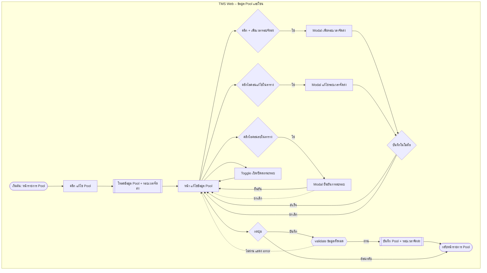
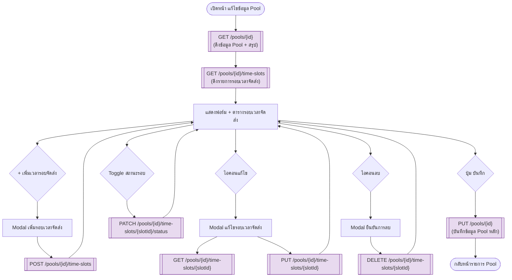

 # Requirement Document: TMS SPRINT – Setup Config Time Slot (รองรับรอบ VIP) ในหน้า "แก้ไขข้อมูล Pool"

## 1. Overview

เอกสารนี้สรุปโครงสร้างหน้าจอ (Screen Flow), รายการฟิลด์/คอมโพเนนต์ และ API ที่แนะนำให้ Implement จากไฟล์ดีไซน์ `Setup Config Time Slot (VIP) Standalone.html` ซึ่งเป็นหน้า **"แก้ไขข้อมูล Pool"** ภายใต้เมนู `ข้อมูลพื้นฐาน > ข้อมูล Pool และโซน > ข้อมูล Pool` ของระบบ CENTRAL GROUP SPRINT (TMS)

หน้าจอนี้ใช้สำหรับตั้งค่าข้อมูลพื้นฐานของ Pool (รหัส/ชื่อ/สถานะ) และตั้งค่า **รอบเวลาจัดส่ง (Time Slot)** ของ Pool นั้น โดยรองรับ 2 ประเภทรอบ คือ **Normal** และ **VIP** ซึ่งแต่ละรอบระบุช่องทางการจัดส่ง (Delivery/Pickup), ช่องทางการขาย (SD/WA/XB/XC), Truck Turn, ช่วงเวลา, Capacity และ Cut Off Time

> **Scope note:** เอกสารนี้ครอบคลุมเฉพาะหน้า "แก้ไขข้อมูล Pool" และรอบเวลาจัดส่งที่ผูกอยู่กับ Pool เท่านั้น **ไม่ครอบคลุม** หน้าจอ ข้อมูลโซนจัดส่ง, ข้อมูลโควต้า Pool, ข้อมูลกำหนดสิทธิ์ Pool และโซนจัดส่ง แม้จะอยู่ในเมนูกลุ่มเดียวกัน — เมนูเหล่านี้ควรทำเป็นเอกสารแยกหากต้องการรายละเอียด API ของแต่ละหน้า
>
> ไฟล์ดีไซน์ที่ได้รับมาเป็น **มุมมองเดียว (static state)** ของหน้า "แก้ไขข้อมูล Pool" เท่านั้น ยังไม่มีดีไซน์ของ Modal "เพิ่ม/แก้ไขรอบเวลาจัดส่ง" และ Modal ยืนยันการลบ — ส่วนของ 2 Modal นี้ในเอกสารเป็น **สมมติฐานที่ประกอบขึ้นจากคอลัมน์ในตาราง** (ดูหัวข้อ 7. Open Items)

## 2. Pain Points / Problem Statement

1. **ไม่มีจุดตั้งค่ารอบ VIP แยกจากรอบ Normal อย่างชัดเจน** — จากตารางรอบเวลาจัดส่งในดีไซน์ พบว่ามีทั้ง Slot Type `Normal` และ `VIP` ปะปนกันในตารางเดียว (เช่น แถวที่ 2, 4, 6, 10) ทีมปฏิบัติการต้องการหน้าจอที่ตั้งค่า/มองเห็นรอบ VIP ได้ชัดเจน พร้อมสรุปจำนวน "รอบ VIP" (สรุปการตั้งค่า: รอบ VIP = 3) แยกจากรอบทั้งหมด (รอบจัดส่งที่เปิดใช้งาน = 9)
2. **ต้องบริหาร Capacity รวมของ Pool เทียบกับผลรวม Capacity ของแต่ละรอบ** — หน้าสรุปแสดง Capacity รวม (880 ออเดอร์) ซึ่งต้องสอดคล้องกับผลรวม Capacity ของทุกรอบในตาราง มิฉะนั้นจะเปิดรับออเดอร์เกินขีดความสามารถจริงของ Pool
3. **ต้องควบคุมความซ้ำซ้อนของช่วงเวลาต่อ Truck Turn** — แต่ละ Pool มีรถวิ่งเป็นรอบ (Truck Turn) การตั้งค่ารอบเวลาจัดส่งที่ทับซ้อนกันในรถรอบเดียวกัน (เช่น Truck Turn เดิม แต่ช่วงเวลาทับกัน) อาจทำให้วางแผนเดินรถผิดพลาด

## 3. Solution

| Feature | Detail |
|---|---|
| หน้าแก้ไขข้อมูล Pool | ตั้งค่าสถานะการใช้งาน, รหัส Pool (read-only), ชื่อ Pool ภาษาไทย/อังกฤษ พร้อมแผงสรุป (Capacity รวม, ช่องทางการขายที่เปิดใช้งาน, รอบจัดส่งที่เปิดใช้งาน, รอบ VIP) |
| ตารางรอบเวลาจัดส่ง (Time Slot Table) | แสดง/จัดการรายการรอบเวลาจัดส่งทั้งหมดของ Pool พร้อม Filter ประเภท Normal/VIP ผ่านคอลัมน์ Slot Type, เปิด/ปิดสถานะรายรอบด้วย Toggle |
| เพิ่มรอบเวลาจัดส่ง | ปุ่ม "+ เพิ่มเวลารอบจัดส่ง" เปิด Modal สำหรับสร้างรอบใหม่ ระบุประเภท Normal/VIP, ช่องทาง, Truck Turn, เวลา, Capacity, Cut Off Time |
| แก้ไข/ลบรอบเวลาจัดส่ง | ไอคอนแก้ไข/ลบต่อแถวในตาราง เปิด Modal แก้ไข หรือ Modal ยืนยันการลบ |
| Validation ความสอดคล้องของข้อมูล | ตรวจสอบผลรวม Capacity, ความซ้ำซ้อนของช่วงเวลาในรถรอบเดียวกัน, ค่าบังคับกรอกของแต่ละฟิลด์ ก่อนบันทึก |

## 4. User Journey

ทั้งหมดเกิดขึ้นบนหน้าจอเดียว (TMS Web – SPA) ภายใต้เมนู ข้อมูลพื้นฐาน > ข้อมูล Pool และโซน > ข้อมูล Pool:

1. ผู้ใช้ (Admin/CFW) เปิดหน้ารายการ Pool แล้วคลิกแก้ไข Pool ที่ต้องการ
2. ระบบเปิดหน้า "แก้ไขข้อมูล Pool" พร้อมโหลดข้อมูล Pool และรอบเวลาจัดส่งทั้งหมดของ Pool นั้น
3. ผู้ใช้แก้ไขสถานะ/ชื่อ Pool ได้ตามสิทธิ์ (รหัส Pool เป็น read-only)
4. ผู้ใช้เพิ่มรอบเวลาจัดส่งใหม่ผ่านปุ่ม "เพิ่มเวลารอบจัดส่ง" หรือแก้ไข/ลบรอบเดิมผ่านไอคอนในตาราง หรือเปิด/ปิดสถานะรายรอบผ่าน Toggle
5. ผู้ใช้กด "บันทึก" เพื่อบันทึกการเปลี่ยนแปลงทั้งหมด หรือกด "ย้อนกลับ" เพื่อออกโดยไม่บันทึก
6. ระบบตรวจสอบความถูกต้อง (validation) แล้วบันทึกและพากลับสู่หน้ารายการ Pool

### 4.1 User Journey Flow Diagram

## 5. Business Rules

1. **รหัส Pool (Pool Code)** เป็นฟิลด์ read-only แก้ไขไม่ได้หลังสร้าง Pool แล้ว
2. **ชื่อ Pool ภาษาไทย** และ **ชื่อ Pool ภาษาอังกฤษ** เป็นฟิลด์บังคับกรอก (มี `*`)
3. **สถานะการใช้งาน (Pool)**: ปิดสถานะ Pool ได้ก็ต่อเมื่อไม่มีรอบเวลาจัดส่งที่ยัง "เปิด" ใช้งานอยู่ หรือระบบต้องแจ้งเตือนผลกระทบก่อนปิด (ต้องยืนยันกับทีม Business — ดู Open Items)
4. **Slot Type** มี 2 ค่า: `Normal`, `VIP` — จำนวนรอบ VIP ที่เปิดใช้งานต้องแสดงในแผงสรุป "รอบ VIP" แยกจากจำนวนรอบทั้งหมด "รอบจัดส่งที่เปิดใช้งาน"
5. **Truck Turn** ในรอบเวลาเดียวกัน (Truck Turn ซ้ำ) ห้ามมีช่วงเวลา (เวลาเริ่มต้น–เวลาสิ้นสุด) ทับซ้อนกัน
6. **Cut Off Time** ต้องอยู่ระหว่างเวลาเริ่มต้นของรอบ ถึงก่อนเวลาสิ้นสุดของวันถัดไปตามที่ธุรกิจกำหนด และควร ≥ เวลาสิ้นสุดของรอบ (ตัวอย่างในดีไซน์: รอบ 08:00–12:00 มี Cut Off 18:00)
7. **Capacity รายรอบ** ต้องเป็นจำนวนเต็มบวก ผลรวม Capacity ของทุกรอบที่ "เปิด" ใช้งาน ไม่ควรเกิน Capacity รวมของ Pool ที่กำหนดไว้
8. **ช่องทางการขายที่เปิดใช้งาน (x / 4)** คำนวณจากจำนวนช่องทางการขาย (SD, WA, XB, XC) ที่มีอย่างน้อย 1 รอบเวลาจัดส่งสถานะ "เปิด" ผูกอยู่
9. การลบรอบเวลาจัดส่งต้องมี Modal ยืนยันก่อนลบจริงเสมอ (ป้องกันการลบพลาด)
10. การกด "ย้อนกลับ" โดยมีการแก้ไขข้อมูลค้างอยู่ (unsaved changes) ควรมีการแจ้งเตือนก่อนออกจากหน้า (ต้องยืนยันกับทีม UX — ดู Open Items)

## 6. Functional Flow และ API ที่แนะนำ

> เนื่องจากไฟล์ดีไซน์ที่ได้รับเป็นหน้าจอที่ดูสมบูรณ์ (มีข้อมูลจริงแสดงอยู่แล้ว) จึงสันนิษฐานว่าฟีเจอร์ "จัดการ Pool" มีอยู่แล้วในระบบ และนี่คือการปรับ/ยืนยัน spec ของหน้าจอนี้ให้รองรับ Slot Type = VIP อย่างสมบูรณ์ ทีม Dev ควรตรวจสอบกับ Backend ปัจจุบันว่า API ใดมีอยู่แล้วและ API ใดต้องสร้างใหม่ (ทำเครื่องหมายในตารางคอลัมน์ "สถานะ" ด้านล่าง)

### 6.1 โหลดข้อมูลหน้า "แก้ไขข้อมูล Pool"

**As-Is:** ไม่ทราบแน่ชัดว่ามี API รวม (aggregate) สำหรับหน้านี้อยู่แล้วหรือไม่ — ต้องยืนยันกับ Backend
**To-Be:**

| Method | Endpoint (แนะนำ)                                | Purpose                                                                                                                     | Response หลัก                                                                                                                                          |
| ------ | ----------------------------------------------- | --------------------------------------------------------------------------------------------------------------------------- | ------------------------------------------------------------------------------------------------------------------------------------------------------ |
| GET    | `/api/v1/pools/{poolId}`                        | ดึงข้อมูล Pool (รหัส, ชื่อ TH/EN, สถานะ) + สรุป (Capacity รวม, ช่องทางการขายที่เปิดใช้งาน, รอบจัดส่งที่เปิดใช้งาน, รอบ VIP) | `poolCode`, `poolNameTh`, `poolNameEn`, `isActive`, `totalCapacity`, `activeSalesChannelCount`, `totalSalesChannel`, `activeSlotCount`, `vipSlotCount` |
| GET    | `/api/v1/pools/{poolId}/time-slots?page=&size=` | ดึงรายการรอบเวลาจัดส่งของ Pool (รองรับแบ่งหน้า ตาม Dropdown "แสดงรายการต่อหน้า": 5/10/20/50)                                | array ของ time slot ตามคอลัมน์ในตาราง                                                                                                                  |
| GET    | `/api/v1/master/delivery-channels`              | Lookup ช่องทางการจัดส่ง (Delivery / Pickup)                                                                                 | `code`, `nameTh`                                                                                                                                       |
| GET    | `/api/v1/master/sales-channels`                 | Lookup ช่องทางการขาย (SD, WA, XB, XC)                                                                                       | `code`, `name`                                                                                                                                         |
| GET    | `/api/v1/master/slot-types`                     | Lookup ประเภทรอบ (Normal / VIP)                                                                                             | `code`, `nameTh`                                                                                                                                       |
| GET    | `/api/v1/pools/{poolId}/truck-turns`            | Lookup ค่า Truck Turn ที่ใช้ได้ของ Pool นี้                                                                                 | `truckTurn`                                                                                                                                            |

### 6.2 เพิ่มรอบเวลาจัดส่งใหม่ (Modal "เพิ่มเวลารอบจัดส่ง")

**As-Is:** ไม่มี (สันนิษฐานว่าต้องสร้างใหม่ — ยังไม่มีดีไซน์ Modal นี้ ดู Open Items)
**To-Be:**

| Method | Endpoint (แนะนำ)                    | Purpose                                                                                                                                                                |
| ------ | ----------------------------------- | ---------------------------------------------------------------------------------------------------------------------------------------------------------------------- |
| POST   | `/api/v1/pools/{poolId}/time-slots` | สร้างรอบเวลาจัดส่งใหม่ Body: `deliveryChannel`, `salesChannel`, `slotType` (`Normal`/`VIP`), `truckTurn`, `startTime`, `endTime`, `capacity`, `cutOffTime`, `isActive` |

Business validation ที่ควรทำฝั่ง Backend: ตรวจ Truck Turn ซ้ำ + เวลาทับซ้อน (Business Rule 5), ตรวจผลรวม Capacity ไม่เกิน Capacity รวมของ Pool (Business Rule 7)

### 6.3 แก้ไขรอบเวลาจัดส่ง (ไอคอน "แก้ไข" ต่อแถว)

**As-Is:** ไม่มี (ต้องสร้างใหม่)
**To-Be:**

| Method | Endpoint (แนะนำ) | Purpose |
|---|---|---|
| GET | `/api/v1/pools/{poolId}/time-slots/{slotId}` | ดึงข้อมูลรอบเวลาจัดส่งรายตัวเพื่อ prefill ฟอร์มแก้ไข |
| PUT | `/api/v1/pools/{poolId}/time-slots/{slotId}` | แก้ไขรอบเวลาจัดส่ง (Body เดียวกับ 6.2) |

### 6.4 เปิด/ปิดสถานะรอบเวลาจัดส่ง (Toggle ในตาราง)

**As-Is:** ไม่มี
**To-Be:**

| Method | Endpoint (แนะนำ) | Purpose |
|---|---|---|
| PATCH | `/api/v1/pools/{poolId}/time-slots/{slotId}/status` | เปิด/ปิดสถานะรอบเวลาจัดส่งแบบ inline (ไม่ต้องรอกด "บันทึก" หลัก) Body: `{ "isActive": true/false }` |

> **หมายเหตุการออกแบบ:** ต้องยืนยันกับทีมว่า Toggle สถานะนี้ Apply ทันที (inline save) หรือรอ "บันทึก" รวมกับฟอร์มหลัก — ถ้าเป็นแบบหลัง ให้รวมค่า `isActive` ไปกับ PUT ของ 6.5 แทนการเรียก PATCH แยก

### 6.5 ลบรอบเวลาจัดส่ง (ไอคอน "ลบ" + Modal ยืนยัน)

**As-Is:** ไม่มี
**To-Be:**

| Method | Endpoint (แนะนำ) | Purpose |
|---|---|---|
| DELETE | `/api/v1/pools/{poolId}/time-slots/{slotId}` | ลบรอบเวลาจัดส่ง หลังผู้ใช้ยืนยันใน Modal |

### 6.6 บันทึกข้อมูล Pool หลัก (ปุ่ม "บันทึก")

**As-Is:** ไม่มี (ต้องยืนยันว่ามี API แก้ไข Pool อยู่แล้วจากหน้าจออื่นหรือไม่)
**To-Be:**

| Method | Endpoint (แนะนำ) | Purpose |
|---|---|---|
| PUT | `/api/v1/pools/{poolId}` | บันทึกสถานะ/ชื่อ Pool (TH/EN) Body: `isActive`, `poolNameTh`, `poolNameEn` |

### 6.7 To-Be Process Flow Diagram (Full Overview)

**Legend (สถานะของแต่ละ API/component):**

- **สีม่วง (New)** — ทุก API ในผัง (`GET /pools/{id}`, `GET /pools/{id}/time-slots`, `POST .../time-slots`, `GET/PUT .../time-slots/{slotId}`, `PATCH .../status`, `DELETE .../time-slots/{slotId}`, `PUT /pools/{id}`) ถือเป็น **สมมติฐาน API ใหม่ทั้งหมด** เนื่องจากไม่มีข้อมูล As-Is ยืนยันว่ามี Backend อยู่แล้ว — **ทีม SA/Dev ต้องตรวจสอบกับระบบจริงก่อน** ว่าตัวใดมีอยู่แล้วและต้องแก้ไขเท่านั้น (existing, modify) เพื่อลด scope งานจริง

## 7. Open Items

- ไม่มีดีไซน์ของ **Modal "เพิ่ม/แก้ไขรอบเวลาจัดส่ง"** แนบมาด้วย — ฟิลด์ในหัวข้อ 6.2/6.3 เป็นการอนุมานจากคอลัมน์ตาราง ต้องขอดีไซน์ Modal จริงหรือยืนยัน field list กับทีม UX ก่อนเริ่ม Dev Front
- ไม่มีดีไซน์ของ **Modal ยืนยันการลบ** — สมมติฐานว่าเป็น confirm dialog มาตรฐานของระบบ
- ยังไม่ยืนยันว่า **Toggle สถานะรายรอบ** (คอลัมน์ สถานะ) เป็น inline-save (เรียก API ทันทีที่ Toggle) หรือรวมอยู่ใน "บันทึก" หลักของหน้า — มีผลต่อจำนวน API และ UX flow (ดูหมายเหตุใน 6.4)
- ยังไม่ยืนยันว่า **สถานะการใช้งาน Pool** ปิดได้เสมอ หรือมีเงื่อนไขบล็อกเมื่อยังมีรอบเวลาจัดส่งเปิดอยู่ (Business Rule 3)
- ยังไม่ยืนยัน **สิทธิ์ผู้ใช้งาน (Permission)** ว่าทุก Role ที่เข้าหน้านี้ได้ มีสิทธิ์ แก้ไข/เพิ่ม/ลบ รอบเวลาจัดส่งเท่ากันหรือไม่ (เมนู "ข้อมูลกำหนดสิทธิ์ Pool และโซนจัดส่ง" ในระบบอาจเกี่ยวข้อง)
- ยังไม่ยืนยัน validation เรื่อง **การแจ้งเตือนเมื่อออกจากหน้าโดยมีข้อมูลค้าง (unsaved changes)** (Business Rule 10)
- Endpoint path ทั้งหมดในเอกสารนี้เป็น **ข้อเสนอแนะ (proposed)** ตาม convention `REST` ทั่วไป — ต้องปรับให้ตรงกับ API Gateway/Naming convention จริงของระบบ SPRINT TMS ก่อนนำไปพัฒนา
