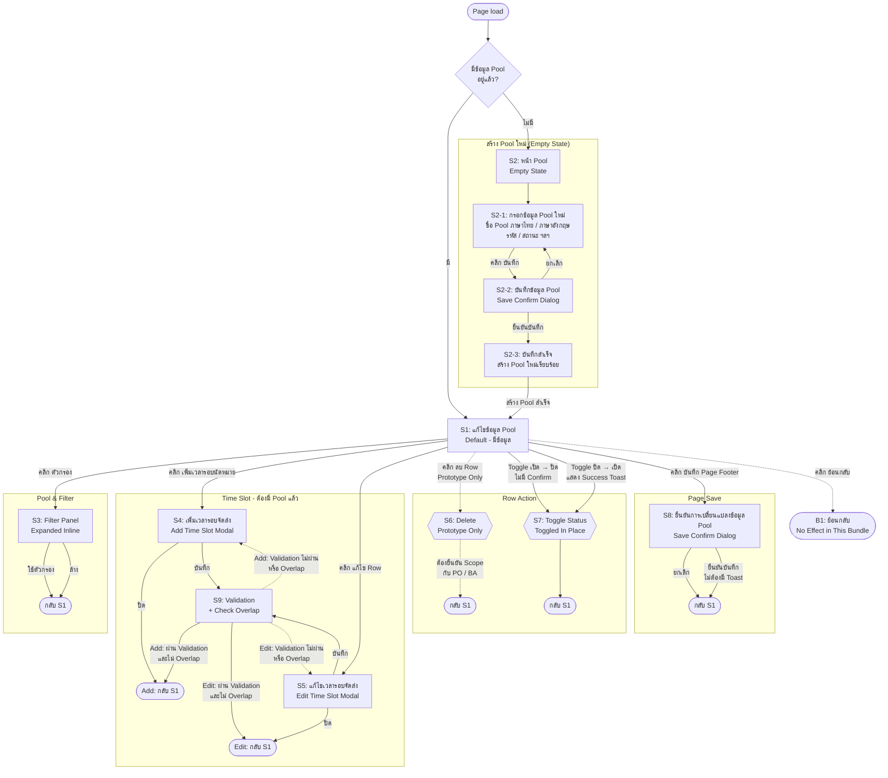

> **⚠️ SUPERSEDED (2026-09-29).** This free-form Screen Flow has been replaced by the
> canonical Design Package under `projects/03-ux-output/SetupConfigTimeSlot/`
> (`screen-registry.json`, `UX-MODEL.md`, `WCAG.md`, `Owner-Result.md`,
> `ScreenFlow.html`, `README.md`). Every fact and PO Decision recorded below has
> been carried forward and re-classified into the new registry. Kept here for
> historical reference only — do not use as the source of truth.

# Setup Config Time Slot — Screen Flow

**Source of truth (exact file, per explicit PO override for this task):**
`D:\Users\tassupawan\Desktop\AI-Office-PO\projects\01-input-from-po\prototype\Setup Config Time Slot (Standalone) - 28092026.html`
(dated **28092026** — this is the only prototype variant used; `Ref/` screenshots, `projects/02-ba-output` BA docs, and the other prototype variants — "Setup Config Time Slot - VIP (Standalone).html" and the "24092026" dated file — were explicitly excluded from this analysis per PO instruction.)

**Feature purpose (one line):** Let TMS operations staff configure, for a single delivery **Pool**, the set of delivery-appointment **time slots** (เวลารอบจัดส่ง) — normal and VIP rounds, per delivery/pickup option and sales channel, with capacity, cut-off and truck-loading windows — and turn individual slots or the whole round on/off.

This document is reverse-engineered strictly from what was clicked and observed in the live-rendered prototype (via browser automation: screenshot, accessibility tree, DOM inspection). Nothing beyond the observed states is asserted as fact; anything inferred is called out explicitly.

**Status:** All 8 open questions from the first pass were reviewed and resolved by PO on 2026-09-28 — see §5 "PO Decisions".

**2026-09-28 update — Create-Pool flow added.** PO supplied an updated Mermaid diagram (§2) adding a page-load decision and a full "create a new Pool" sub-flow (S2 → S2-1 → S2-2 → S2-3) plus an explicit shared validation node (S9) for the Add/Edit Time Slot modals. **The entire Create-Pool sub-flow (S2/S2-1/S2-2/S2-3) is a NEW requirement — it was not found anywhere in the prototype file during exploration** (the prototype's รหัส Pool field is read-only and pre-filled with an existing Pool `P0230`; no "create new Pool" affordance was ever reachable). PO confirmed this explicitly: it has no prototype/visual reference yet and must be designed from scratch. Section 1 below is updated to match this diagram; every new/renumbered screen is labelled **[NEW — no prototype reference]** where applicable. This is now ready to hand to `ui-designer` for the visual/hi-fi design pass — the Create-Pool screens in particular need `ui-designer` to design from DESIGN.md tokens alone, same as any other net-new pattern.

---

## 1. Screen / State Inventory

### S0 — Page Load Decision — `page-load-routing` **[NEW — no prototype reference]**
**Trigger:** Page load / navigation into this feature.

**Logic:** `D1: มีข้อมูล Pool อยู่แล้วหรือไม่?`
- **มี** (a Pool record already exists for this context) → **S1** (Default, populated form — this is the only path the prototype file itself demonstrates).
- **ไม่มี** (no Pool record exists yet) → **S2** (Create-Pool entry — new flow, §below).

**Open question:** the prototype never exposed *how* this routing decision is made (e.g. navigating from a Pool List's "แก้ไข" vs. "เพิ่ม Pool ใหม่" action, or a route parameter). Not blocking, but `ui-designer`/`angular-implementer` will need the actual entry mechanism from BA/the Pool List screen before wiring real navigation.

---

### S1 — แก้ไขข้อมูล Pool — `pool-edit`
**Entry point(s):** From **S0** when a Pool already exists; from **S2-3** after successfully creating a new Pool (lands here with zero time slots); return target after closing any modal/dialog on this screen; return target after "ล้าง"/"ใช้ตัวกรอง".

**States of this one screen** (confirmed by PO: this is a single screen with two table-content states, not two separate screens):
- **มีข้อมูล (populated)** — table has ≥1 time-slot rows. This is what the prototype renders by default (verified, 10 rows for Pool P0230).
- **ไม่มี Time Slot (empty table)** — same form, same layout, zero rows. Reached either (a) via the prototype's own demo toggle "ไม่มีข้อมูล (Empty State)" showing this same Pool P0230 with an emptied table (verified in the prototype), or (b) after creating a brand-new Pool via S2-3, which naturally has zero configured time slots yet. Content: KPI tiles all `0` / `0 / 0`; table replaced by centered message **"ยังไม่มีข้อมูลเวลารอบจัดส่งสำหรับ Pool นี้"**; no filter button; "เพิ่มเวลารอบนัดหมาย" stays visible/enabled; footer unchanged.

**Purpose:** Single edit form for one Pool's basic data plus the full list of its configured delivery-appointment time slots.

**Key content:**
- Demo-only state switch (top of page, not part of the real UI): **"มีข้อมูล"** / **"ไม่มีข้อมูล (Empty State)"** toggle pair — lets the prototype author preview both data states. Treated as a prototype-authoring aid, not a product control.
- Breadcrumb: home icon › ข้อมูล Pool › แก้ไขข้อมูล Pool
- Card "ข้อมูล Pool":
  - สถานะการใช้งาน * — toggle switch, shows "เปิด" (in every observed click this toggle did not visibly change state — **confirmed by PO: prototype limitation, not a real product constraint; the real screen must let this toggle work**)
  - รหัส Pool * — text field, **read-only** (`readonly` in DOM), pre-filled `P0230`
  - ชื่อ Pool (ภาษาไทย) * — editable text field, pre-filled "Pool บางนา"
  - ชื่อ Pool (ภาษาอังกฤษ) * — editable text field, pre-filled "Pool Bangna"
- "สรุปการตั้งค่า" summary card — 4 read-only KPI tiles, recomputed live as the slot table changes:
  - Capacity รวม (ออเดอร์)
  - ช่องทางการขายที่เปิดใช้งาน (e.g. "3 / 4")
  - รอบจัดส่งที่เปิดใช้งาน (count of enabled slots)
  - รอบ VIP (count of VIP slots)
- Toolbar: **ตัวกรอง** (Filter, toggle button with count badge when active) · **เพิ่มเวลารอบนัดหมาย** (primary button, add time slot)
- Data table — columns: ลำดับ, ช่องทางการจัดส่ง (Delivery/Pickup), ช่องทางการขาย (sales channel, "-" for VIP rows), Slot Type (Normal/VIP), Truck Turn, เวลาเริ่มต้น, เวลาสิ้นสุด, Duration, Capacity, Cut Off Time, เวลาโหลดเริ่มต้น, เวลาโหลดสิ้นสุด, สถานะ (inline toggle, เปิด/ปิด), รายละเอียด (row actions: แก้ไข / ลบ icon buttons)
  - Observed sample: 10 rows initially (7 Delivery + 3 Pickup rows; 3 of the 10 are VIP)
  - VIP rows render Slot Type in an accent colour and always show "-" for ช่องทางการขาย
- Paginator: page-size select (5/10/20/50), หน้าแรก/ก่อนหน้า/ถัดไป/หน้าสุดท้าย, "x – y of n" counter
- Page-level footer buttons: **ย้อนกลับ** (secondary) · **บันทึก** (primary)

**Exit actions → destinations:**

| Action | Destination |
|---|---|
| Click "ไม่มีข้อมูล (Empty State)" (prototype demo toggle only) | → S1, same screen switches to its "ไม่มี Time Slot" table state (not a separate screen — see states list above) |
| Click "ตัวกรอง" | → S3 FilterPanel-Expanded (inline, same screen) |
| Click "เพิ่มเวลารอบนัดหมาย" | → S4 AddTimeSlotModal |
| Click a row's "แก้ไข" icon | → S5 EditTimeSlotModal |
| Click a row's "ลบ" icon | Prototype: row removed immediately. **PO decision: this must NOT actually be allowed** — deleting a time slot breaks report integrity (historical reports reference the slot). See S6. |
| Click a row's "สถานะ" toggle | → status flips **immediately** in place, summary KPIs recompute, stays on S1 |
| Change page-size select / paginator arrows | → table re-paginates, stays on S1 |
| Click "ย้อนกลับ" | → no observable effect in this standalone bundle. **Confirmed correct by PO** — its real destination (a Pool list screen) is outside this file's scope; no change needed. |
| Click "บันทึก" (page footer) | → S8 SaveConfirmDialog |

**States tied to this screen:** default (populated), filtered (chip + "(n)" badge on the Filter button), paginated.

---

### S2 — หน้า Pool · Empty State (no Pool exists) — `pool-create-entry` **[NEW — no prototype reference]**
**Entry point:** From **S0** when `D1` = "ไม่มี" (no Pool record exists at all for this context).

**Purpose:** Entry point into creating a brand-new Pool. This is a page-level empty state (no Pool selected/created yet), distinct from S1's own "ไม่มี Time Slot" table state — S2 means there is no Pool data to show at all, not just an empty time-slot table.

**Note:** No visual reference exists for this screen — it is not in the prototype file. `ui-designer` should design it as a standard empty-state pattern (per CLAUDE.md §3 rule 8, this relies on the **[proposed]** empty-state pattern — flag it) with a clear call to action leading into S2-1.

**Exit actions → destinations:**

| Action | Destination |
|---|---|
| (call-to-action, e.g. "สร้าง Pool ใหม่" — exact label TBD, not in prototype) | → S2-1 |

---

### S2-1 — กรอกข้อมูล Pool ใหม่ — `pool-create-form` **[NEW — no prototype reference]**
**Entry point:** From S2.

**Purpose:** Form to enter a new Pool's data before first save.

**Fields (per PO's diagram; exact field list TBD against S1's "ข้อมูล Pool" card since no prototype reference exists):** ชื่อ Pool (ภาษาไทย) *, ชื่อ Pool (ภาษาอังกฤษ) *, รหัส Pool * (likely system-generated or user-entered — unlike S1 where it is read-only/pre-filled; needs BA confirmation), สถานะการใช้งาน *, and any other fields BA/API spec requires for Pool creation not covered by this Screen Flow (this doc only covers the Setup Config Time Slot prototype, not a Pool-creation API spec).

**Exit actions → destinations:**

| Action | Destination |
|---|---|
| Click "บันทึก" | → S2-2 |

---

### S2-2 — บันทึกข้อมูล Pool · Save Confirm Dialog — `pool-create-confirm` **[NEW — no prototype reference]**
**Entry point:** Click "บันทึก" on S2-1.

**Purpose:** Confirm before creating the new Pool record. Same pattern family as S8 (page-level save confirm) — reuse that component.

**Exit actions → destinations:**

| Action | Destination |
|---|---|
| Click "ยกเลิก" | → back to S2-1, no change |
| Click "ยืนยันบันทึก" | → S2-3 |

---

### S2-3 — บันทึกสำเร็จ · Pool Created — `pool-create-success` **[NEW — no prototype reference]**
**Entry point:** Click "ยืนยันบันทึก" on S2-2.

**Purpose:** Confirms the new Pool was created successfully.

**Open question:** PO's diagram shows this as a distinct success step (not just a toast) before landing on S1 — needs `ui-designer`/PO to decide whether this is a dedicated success screen/panel or a toast + immediate redirect to S1. Not resolved by this pass; flag in §5.

**Exit actions → destinations:**

| Action | Destination |
|---|---|
| (auto or on acknowledgement) | → **S1**, in its "ไม่มี Time Slot" (empty table) state — the new Pool has zero time slots configured yet |

---

### S3 — ตัวกรอง · Filter Panel Expanded — `filter-panel`
**Entry point:** Click "ตัวกรอง" button on S1. Renders inline (pushes the table down), not a modal.

**Purpose:** Narrow the time-slot table by sales channel / delivery option / slot type.

**Key content:**
- ช่องทางการขาย — dropdown, default "ทั้งหมด"
- Delivery Option — dropdown: ทั้งหมด / Delivery / Pickup
- Slot Type — dropdown: ทั้งหมด / Normal / VIP
- Buttons: **ล้าง** (Clear) · **ใช้ตัวกรอง** (Apply)

**Observed behaviour:** Setting Slot Type = VIP and clicking "ใช้ตัวกรอง" filtered 9→4 rows, added a "(1)" count badge to the "ตัวกรอง" button, and showed an active-filter chip **"Slot Type: VIP"** above the table. Clicking "ล้าง" reset the table to all rows and removed the chip/badge.

**PO confirmation:** clicking the "ตัวกรอง" toggle button again just closes the panel (no filter is applied by that click alone); the filter values are only actually applied to the table when "ใช้ตัวกรอง" is pressed. Confirmed correct — no change needed.

**Exit actions → destinations:**

| Action | Destination |
|---|---|
| Click "ใช้ตัวกรอง" | → S1, table filtered, chip + badge shown |
| Click "ล้าง" | → S1, filters cleared |
| Click "ตัวกรอง" again (toggle) | → collapses the panel only; does not itself change/apply the filter. **Confirmed by PO.** |

---

### S4 — เพิ่มเวลารอบจัดส่ง · Add Time Slot Modal — `add-timeslot-modal`
**Entry point:** Click "เพิ่มเวลารอบนัดหมาย" from S1 (in either of its two states — populated or empty table).

**Purpose:** Create a new time-slot row for this Pool.

**Fields:**
- ช่องทางการจัดส่ง * — select: Delivery / Pickup (default "Delivery")
- Slot Type — checkbox "เป็นรอบ VIP (VIP Slot)"
- ช่องทางการขาย — select: ไม่ระบุ / SD - Store Delivery / WA - Online Web Application / XB - X-Booster / XC - X-Credit (default "ไม่ระบุ")
- Truck Turn * — select: 1 / 2 / 3 (default "1")
- เวลาเริ่มต้น * — time field, opens a scrollable 15-minute-increment time-picker dropdown on click (00:00, 00:15, 00:30 … observed); empty by default
- เวลาสิ้นสุด * — same time-picker control; empty by default
- Duration (จำนวนวันล่วงหน้าของ Cut off) — numeric text field
- Capacity — numeric text field
- Cut Off Time * — time field (same picker pattern)
- เวลาโหลดเริ่มต้น * — time field
- เวลาโหลดสิ้นสุด * — time field
- Footer: **ปิด** (Close/cancel) · **บันทึก** (Save)

**Observed behaviour / validation:** Submitting "บันทึก" with the two required time fields (เวลาเริ่มต้น, เวลาสิ้นสุด) left empty closed the modal silently — **no new row was added to the table, and no inline error/validation message was shown.** This is *not* the target behaviour — see PO decision below.

**PO decision (validation rule, per API spec):** on "บันทึก", the form must validate for **overlap between the new/edited slot's time range and existing slots** — specifically checking overlap against both **Slot Time** (เวลาเริ่มต้น–เวลาสิ้นสุด) and **Load Time** (เวลาโหลดเริ่มต้น–เวลาโหลดสิ้นสุด). An overlapping slot must be blocked with a visible inline error, not silently closed. Required-field emptiness should likewise block submit with a visible error (not observed in the prototype — flag for `ui-designer`/`angular-implementer` to design the error state, since no error UI exists in this prototype to reference). **This shared validation step is modeled explicitly as S9 below** (both S4 and S5 route through it on "บันทึก").

**Exit actions → destinations:**

| Action | Destination |
|---|---|
| Click "ปิด" | → back to S1, no change |
| Click "บันทึก" | → **S9** (validation + overlap check) |

---

### S5 — แก้ไขเวลารอบจัดส่ง · Edit Time Slot Modal — `edit-timeslot-modal`
**Entry point:** Click a row's "แก้ไข" (pencil) icon in the S1 table.

**Purpose:** Edit an existing time-slot row. Same field set and layout as S4, pre-filled with that row's current values (verified: ช่องทางการจัดส่ง=Delivery, ช่องทางการขาย=SD - Store Delivery, Truck Turn=1, เวลาเริ่มต้น=08:00 all pre-populated for row 1).

**Exit actions → destinations:**

| Action | Destination |
|---|---|
| Click "ปิด" | → back to S1, no change |
| Click "บันทึก" | → **S9** (validation + overlap check) |

---

### S9 — Validation + Check Overlap — `timeslot-validation` **[formalizes PO decision #2 — no dedicated screen, a shared logic gate for S4/S5]**
**Trigger:** "บันทึก" clicked on S4 (Add) or S5 (Edit).

**Purpose:** Single shared validation gate for both the Add and Edit Time Slot modals — not a screen the user sees standing alone, but modeled as its own node because both modals route through identical logic before either succeeding or bouncing back with an error.

**Rule (per PO decision, API spec):** validate the submitted slot's time range for **overlap against existing slots**, checked on both **Slot Time** (เวลาเริ่มต้น–เวลาสิ้นสุด) and **Load Time** (เวลาโหลดเริ่มต้น–เวลาโหลดสิ้นสุด). Also validate required fields are non-empty. None of this validation/error UI exists in the prototype (which silently closed the modal on empty fields) — this is a gap `ui-designer` must design fresh.

**Exit actions → destinations:**

| Outcome | Destination |
|---|---|
| Add: passes validation, no overlap | → back to S1, new row appended, summary KPIs recompute |
| Edit: passes validation, no overlap | → back to S1, row updated in place, summary KPIs recompute |
| Add: fails validation or overlaps | → **stays on S4** with a visible inline error (per-field and/or banner — TBD by `ui-designer`) |
| Edit: fails validation or overlaps | → **stays on S5** with the same error treatment |

---

### S6 — ลบ · Delete row action — `delete-row-action`
**Trigger:** Click a row's "ลบ" (trash) icon in the S1 table.

**Observed behaviour (prototype only):** The row is removed from the table **immediately on click — no confirmation dialog appears.** "แสดง n จาก n รายการ" count and the summary KPI tiles (Capacity รวม, รอบจัดส่งที่เปิดใช้งาน) update instantly (verified: 10 rows/880 capacity → 9 rows/780 capacity after deleting row 1).

**PO decision — this behaviour is rejected for the real screen:** hard-deleting a time slot is **intentionally disallowed**, because a time slot can be referenced by historical/report data (e.g. Report ที่อ้างอิง Slot เดิม) and deleting it would break that reporting. Implication for `ui-designer`:
- The "ลบ" icon/action as observed (immediate hard delete) **must not** be carried into the real design.
- Recommended real-world equivalent: remove the delete affordance from the row-actions column entirely, and rely on the existing **สถานะ (เปิด/ปิด)** toggle (S7) as the only way to retire a slot — i.e. "deactivate", not "delete", preserving the row for reporting.
- This needs one more explicit confirmation from PO/BA before `ui-designer` builds it: **should the "ลบ" icon be removed from the table entirely, or kept but restricted (e.g. only allowed when the slot has zero historical usage)?** Flagged as the one remaining open item (see §5).

**Exit:** Stays on S1. In the prototype, with the row removed; in the real design, this action should not exist in this form.

---

### S7 — สถานะ · Row status toggle — `row-status-toggle`
**Trigger:** Click the เปิด/ปิด toggle switch in a row's สถานะ column.

**Observed behaviour:** Flips immediately between "เปิด" and "ปิด", no confirmation, no toast. Summary KPIs (Capacity รวม, รอบจัดส่งที่เปิดใช้งาน) recompute live to exclude/include that row (verified: toggling row 1 off dropped Capacity รวม from 780 to 680 and รอบจัดส่งที่เปิดใช้งาน from 8 to 7).

**PO decision:** toggling a row **on** (activating a slot, ปิด → เปิด) should show a **success toast** confirming the action. No toast is needed for toggling off. (No toast is needed for S8 page-level Save either — see below.)

**Exit:** Stays on S1. Real design: show a success toast only on the ปิด→เปิด transition.

---

### S8 — ยืนยันการเปลี่ยนแปลงข้อมูล · Save Confirmation Dialog — `save-confirm-dialog`
**Trigger:** Click the page-level "บันทึก" button in the footer of S1 (in either of its table states).

**Purpose:** Final confirmation before persisting the Pool's data-and-time-slot changes made during this session (edits to Pool name fields, added/edited/deleted/toggled time-slot rows are all held as pending local state until this step).

**Content:** Warning icon + heading "ยืนยันการเปลี่ยนแปลงข้อมูล" + body text "คุณต้องการบันทึกการเปลี่ยนแปลงค่า Pool และเวลารอบจัดส่งนี้หรือไม่?" + buttons **ยกเลิก** (Cancel) · **ยืนยันบันทึก** (Confirm Save).

**Exit actions → destinations:**

| Action | Destination |
|---|---|
| Click "ยกเลิก" | → back to S1, dialog closes, no save (inferred from standard cancel pattern; not separately re-tested) |
| Click "ยืนยันบันทึก" | → dialog closes, back to S1. No success toast was detected — **confirmed correct by PO: no toast is intended here.** |

---

## 2. Screen Flow Diagram (Mermaid)



---

## 3. Prototype-only vs. Real-screen affordances

These were clicked and confirmed **not to produce any change**, and are therefore treated as prototype/demo artifacts or as pointing to screens outside this bundle, not as part of the Screen Flow above:

- Sidebar items other than the active "ข้อมูล Pool" (ข้อมูลโซนจัดส่ง, ข้อมูลโควต้า Pool, ข้อมูลกำหนดสิทธิ์ Pool และโซนจัดส่ง, ข้อมูลสาขา, ข้อมูลรถขนส่ง, ข้อมูลพนักงานขนส่ง, ข้อมูลบริษัทขนส่ง, ข้อมูลโควต้า, ข้อมูลวันหยุดสาขา, ข้อมูลวันหยุดขนส่ง, การขาย, ระบบจัดเส้นทาง, ประวัติการสั่งซื้อสินค้า, รายงาน) — clicking them left the page unchanged. Only "ข้อมูล Pool" (this screen) is implemented in this standalone bundle.
- The "มีข้อมูล" / "ไม่มีข้อมูล (Empty State)" pill switch itself is a prototype-authoring control (a toggle to preview two states of the same screen), not a control a real end user would see in production — flagged so it is **not** carried into the UI design as a real button.
- **The entire Create-Pool sub-flow (S2, S2-1, S2-2, S2-3) has no prototype counterpart at all.** It was added on 2026-09-28 per PO's updated Mermaid diagram as a new requirement layered on top of this Screen Flow, not something reverse-engineered from `Setup Config Time Slot (Standalone) - 28092026.html`. Treat §1's S2/S2-1/S2-2/S2-3 entries as a design brief, not an observation.

---

## 4. Wireframe notes (structure, not visual) for S1 (representative — richest screen)

```
[Breadcrumb: หน้าหลัก › ข้อมูล Pool › แก้ไขข้อมูล Pool]
[Page title: แก้ไขข้อมูล Pool]
[Card: ข้อมูล Pool]
  [Toggle: สถานะการใช้งาน *]
  [Field: รหัส Pool * (read-only)]
  [Field: ชื่อ Pool (ภาษาไทย) *]
  [Field: ชื่อ Pool (ภาษาอังกฤษ) *]
[Card: สรุปการตั้งค่า]
  [KPI x4: Capacity รวม | ช่องทางการขายที่เปิดใช้งาน | รอบจัดส่งที่เปิดใช้งาน | รอบ VIP]
[Toolbar row: ตัวกรอง (left) ... เพิ่มเวลารอบนัดหมาย (right, primary)]
[Filter panel: collapsible, 3 dropdowns + ล้าง/ใช้ตัวกรอง - only when expanded]
[Result count label: แสดง n จาก n รายการ]
[Table: 13 columns incl. inline status toggle + row action icons]
[Paginator: page-size select · nav arrows · "x-y of n"]
[Footer action bar: ย้อนกลับ (secondary, left) ... บันทึก (primary, right)]
```

---

## 5. PO Decisions (resolved 2026-09-28)

The 8 items originally raised as open questions were reviewed with PO. Resolutions:

1. **Delete has no confirmation dialog.** → **Rejected as a real-screen behaviour.** PO: hard-delete is intentionally disallowed because it breaks Report data that references the slot. The "ลบ" icon/immediate-delete pattern from the prototype must not be carried into the real design; use the existing สถานะ toggle (deactivate) instead. **One item still needs a follow-up PO/BA call: remove the "ลบ" icon from the table entirely, or keep it but restrict it (e.g. only when the slot has zero historical usage)?** This is the one remaining open item blocking `ui-designer`'s table row-actions design — see §1 S6.
2. **Add/Edit Time Slot modal shows no visible validation.** → Resolved. Per API spec, "บันทึก" must validate **overlap of the new/edited slot against existing slots on both Slot Time (เวลาเริ่มต้น–เวลาสิ้นสุด) and Load Time (เวลาโหลดเริ่มต้น–เวลาโหลดสิ้นสุด)**, blocking submit with a visible inline error on conflict (and on empty required fields). See §1 S4.
3. **Pool-level "สถานะการใช้งาน" toggle didn't respond to clicks.** → Resolved: confirmed a prototype limitation only, not a real constraint. The real screen's toggle must be functional.
4. **"ย้อนกลับ" button has no observed effect.** → Resolved: confirmed correct as-is (its target, a Pool list screen, is outside this file's scope; no change needed).
5. **No success toast after Save (S8).** → Resolved: confirmed intentional — no toast on page-level Save. However, PO added a new requirement: **toggling a row's สถานะ from ปิด → เปิด (activating a slot) should show a success toast.** See §1 S7.
6. **Filter panel collapse-on-second-click (inferred).** → Resolved/confirmed: clicking "ตัวกรอง" again only collapses the panel; it does not apply a filter by itself — only "ใช้ตัวกรอง" applies the filter values. See §1 S3.
7. **Cancel in the Save Confirm Dialog (not independently re-verified).** → No PO objection raised; kept as originally documented (returns to S1 without saving, per standard dialog convention). Not independently re-tested in this pass either — low risk, standard pattern.
8. **Unrelated browser clipboard-write side effect on "เพิ่มเวลารอบนัดหมาย" click.** → PO flagged this for likely removal. Recommendation: this is very likely leftover prototype-authoring/debug code (e.g. a "copy JSON" or similar dev helper wired to the button by mistake) with no product purpose — **flag for engineering to strip it out**; it should not be replicated in the real build. Needs a quick confirmation from whoever built the prototype on what triggered it, but there is no reason to keep it either way.

All screens/states in §1 were reached and directly observed in the prototype. With the above resolved, the only remaining blocker before handing this to `ui-designer` is the delete-icon scope question in item 1.

9. **(2026-09-28) Create-Pool flow added — new requirement, no prototype reference.** PO confirmed via clarifying questions: (a) S2 now means "no Pool data exists yet" and is the entry to a full create-Pool sub-flow (S2-1 form → S2-2 confirm → S2-3 success), landing on S1 in its empty-table state afterward — this is additive, not a replacement of S1's own empty-table state, which stays as documented; (b) this whole sub-flow is a new requirement not present in or verifiable against the prototype file. Two follow-ups still open:
   - **S2-1 field list** (exact fields for creating a new Pool, e.g. is รหัส Pool system-generated or user-entered) needs BA/API-spec confirmation — this Screen Flow only ever observed รหัส Pool as read-only/pre-filled in an *edit* context.
   - **S2-3's presentation** (a dedicated "success" screen/panel vs. a toast + immediate redirect to S1) is not decided — PO's diagram models it as a distinct step, but this needs a design decision from `ui-designer`/PO before build.
